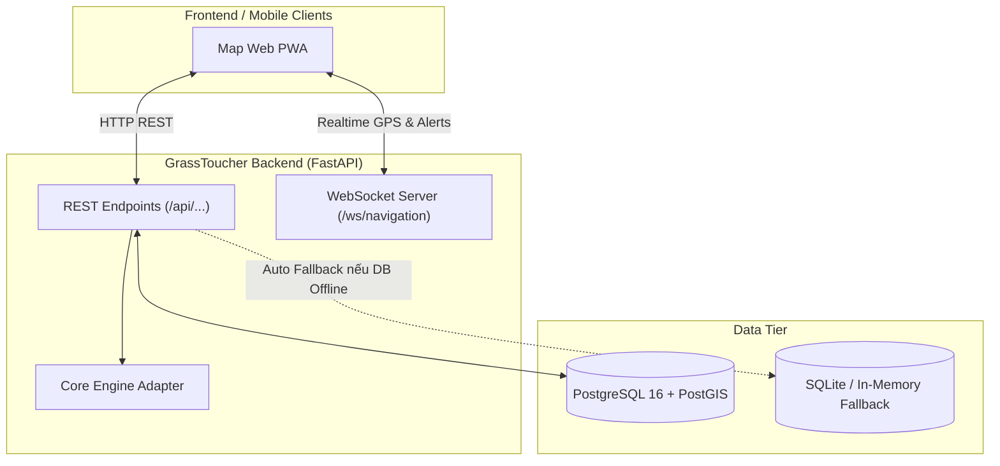

# 🚀 GrassToucher Backend – Real-time Flood Navigation & Geo-API Gateway

[](https://opensource.org/licenses/Apache-2.0)
[](https://opensource.org/licenses)
[](https://fastapi.tiangolo.com)
[](https://postgis.net/)
[](https://websockets.readthedocs.io/)
[](https://www.python.org/)

> **Cổng giao tiếp dịch vụ API RESTful và WebSocket dẫn đường thông minh thời gian thực.**  
> Dự án 100% Mã nguồn mở, tích hợp cơ sở dữ liệu không gian PostGIS và cơ chế dự phòng tự động (Serverless-ready).

---

## 🏗️ 1. Kiến trúc Hệ thống



---

## 📡 2. Danh mục API chính (OpenAPI Specification)

| Phương thức | Đường dẫn | Chức năng nghiệp vụ |
|---|---|---|
| **GET** | `/api/health` | Kiểm tra trạng thái hệ thống, kết nối PostGIS và chế độ Fallback |
| **GET / POST** | `/api/flood-points` | Danh sách 130 điểm ngập (GeoJSON) / Tạo trạm quan trắc mới |
| **POST** | `/api/readings` | Cảm biến IoT gửi chuỗi thời gian mực nước |
| **POST** | `/api/reports` | Báo cáo ngập cộng đồng (Tự xác nhận khi $\ge 3$ báo cáo / 100m / 15p) |
| **POST** | `/api/route` | Tìm 2 lộ trình song song: **Nhanh nhất** và **Né ngập an toàn** |
| **GET** | `/api/weather/hanoi` | Lấy dữ liệu lượng mưa thực tế theo giờ từ Open-Meteo API |
| **GET** | `/api/predictions` | Dự báo mực nước dâng sau 30/60 phút bằng Scikit-Learn |
| **WS** | `/ws/navigation/{session_id}` | Kênh WebSocket hai chiều theo dõi GPS và tự động **Re-routing** |

Tài liệu Swagger UI tương tác trực tiếp có sẵn tại: `http://localhost:8000/docs`

---

## ⚡ 3. Hướng dẫn Cài đặt & Khởi chạy

### Bước 1: Tạo môi trường ảo & Cài đặt thư viện
```bash
git clone https://github.com/GrassTouchers1/GrassToucher-backend.git
cd GrassToucher-backend

python -m venv venv
# Windows:
.\venv\Scripts\activate
# Linux/Mac:
source venv/bin/activate

pip install -r requirements.txt
```

### Bước 2: Cấu hình cơ sở dữ liệu (Tùy chọn)
- Sao chép file `.env.example` thành `.env`:
  ```bash
  copy .env.example .env   # Linux/Mac: cp .env.example .env
  ```
- Điền `DATABASE_URL` tới máy chủ PostgreSQL + PostGIS của bạn.
- Khởi tạo bảng và nạp dữ liệu mẫu:
  ```bash
  python db/setup_db.py
  ```
*(Lưu ý: Nếu không cấu hình PostgreSQL, hệ thống sẽ tự động kích hoạt chế độ SQLite / In-Memory Fallback để phục vụ phát triển ngay lập tức).*

### Bước 3: Khởi chạy Server
- **Cách 1 (Windows):** Nhấp đúp vào [run_backend.bat](run_backend.bat).
- **Cách 2 (Dòng lệnh):**
  ```bash
  uvicorn app.main:app --reload --host 127.0.0.1 --port 8000
  ```

---

## 📄 4. Giấy phép Bản quyền (License)
Phát hành theo giấy phép **Apache License 2.0 (OSI-Approved)**. Xem chi tiết tại [LICENSE](LICENSE).  
Quy định tham gia đóng góp: [CONTRIBUTING.md](CONTRIBUTING.md).
