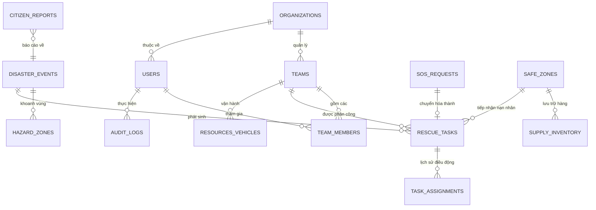

# BẢN THIẾT KẾ CƠ SỞ DỮ LIỆU TỔNG THỂ
## DATABASE ARCHITECTURE & DDL SPECIFICATION – NORTHSTAR RESCUE OS

> **Dự án:** NORTHSTAR – Open-source Emergency Response OS  
> **Hệ quản trị CSDL:** PostgreSQL 16 + PostGIS Extension (Sử dụng SQLite In-Memory cho chế độ Dự phòng Circuit Breaker)  
> **Quy chuẩn mã hóa:** UTF-8, Hệ tọa độ không gian WGS 84 (SRID 4326) & Hệ chiếu phẳng mét UTM (SRID 3857).  

---

## 1. SƠ ĐỒ THỰC THỂ QUAN HỆ (ENTITY RELATIONSHIP DIAGRAM - ERD)



---

## 2. BẢNG MÃ HÓA & CÁC ENUMS NGHIỆP VỤ

```sql
-- 1. Phân quyền vai trò người dùng trong hệ thống
CREATE TYPE user_role AS ENUM (
    'citizen',          -- Người dân (Không bắt buộc tài khoản khi gửi SOS)
    'rescuer',          -- Thành viên đội cứu hộ hiện trường
    'team_leader',      -- Đội trưởng đội cứu hộ (duyệt quân số, nhận lệnh)
    'dispatcher',       -- Điều phối viên tác chiến tại trung tâm chỉ huy
    'commander',        -- Chỉ huy trưởng Ban Chỉ huy PCTT & TKCN
    'sys_admin'         -- Quản trị viên kỹ thuật hệ thống
);

-- 2. Trạng thái vòng đời của yêu cầu cứu hộ SOS
CREATE TYPE sos_status AS ENUM (
    'draft',            -- Bản nháp lưu cục bộ tại thiết bị ngoại tuyến
    'pending',          -- Đã gửi tới máy chủ, đang chờ AI lọc trùng & phân cấp
    'acknowledged',     -- Ban chỉ huy đã tiếp nhận và xác thực
    'dispatched',       -- Đã giao cho Đội cứu hộ cụ thể
    'in_progress',      -- Đội cứu hộ đã tiếp cận hiện trường và đang giải cứu
    'transporting',     -- Đang vận chuyển nạn nhân về nơi an toàn
    'resolved',         -- Đã cứu hộ thành công và bàn giao an toàn
    'cancelled',        -- Báo động giả hoặc đã tự thoát hiểm an toàn
    'unreachable'       -- Tạm thời mất dấu hoặc không thể tiếp cận do địa hình hiểm trở
);

-- 3. Mức độ ưu tiên tác chiến khẩn cấp
CREATE TYPE priority_level AS ENUM (
    'low',              -- Ưu tiên thấp: Thiệt hại tài sản nhỏ, người dân an toàn
    'medium',           -- Ưu tiên trung bình: Nước dâng chậm, còn lương thực
    'high',             -- Ưu tiên cao: Nước ngập tầng 1, có nguy cơ cô lập
    'critical'          -- CỰC KỲ NGUY CẤP: Đe dọa trực tiếp tính mạng (Trẻ em, người già, nước ngập mái, sạt lở)
);

-- 4. Phân loại loại hình thiên tai & hiểm họa
CREATE TYPE hazard_type AS ENUM (
    'flood',            -- Ngập lụt đô thị / lũ đồng bằng
    'flash_flood',      -- Lũ quét vùng cao / lũ ống
    'landslide',        -- Sạt lở đất đá taluy / sập núi
    'storm',            -- Bão nhiệt đới / giông lốc
    'dam_breach',       -- Vỡ đê / sự cố xả lũ hồ chứa
    'electrical_hazard',-- Sự cố rò rỉ điện / đổ cột điện chìm trong nước
    'bridge_collapse',  -- Sập cầu cống / chia cắt giao thông
    'other'
);

-- 5. Loại phương tiện & nguồn lực cứu hộ
CREATE TYPE vehicle_type AS ENUM (
    'inflatable_boat',  -- Xuồng cao su hơi cứu hộ (cơ động ngõ nhỏ)
    'motor_boat',       -- Ca-nô máy công suất lớn (sông rộng, dòng chảy xiết)
    'high_clearance_truck', -- Xe tải quân sự gầm cao lội nước
    'amphibious',       -- Xe thiết giáp lội nước đặc chủng
    'helicopter',       -- Trực thăng cứu nạn cứu hộ đường không
    'drone_uav',        -- Flycam trinh sát tầm nhiệt & thả phao cứu sinh
    'ambulance'         -- Xe cứu thương vận chuyển cấp cứu y tế
);
```

---

## 3. ĐẶC TẢ CHI TIẾT CÁC BẢNG DỮ LIỆU (DDL SCHEMAS)

### 3.1. Phân hệ Tổ chức, Đội cứu hộ & Người dùng

```sql
-- Bảng 1: Các đơn vị, tổ chức tham gia cứu nạn
CREATE TABLE organizations (
    id SERIAL PRIMARY KEY,
    name VARCHAR(150) NOT NULL,
    org_type VARCHAR(50) NOT NULL, -- 'military', 'police_114', 'red_cross', 'volunteer_club', 'government'
    jurisdiction_area VARCHAR(100), -- Khu vực quản lý (VD: 'Thái Nguyên', 'Lào Cai', 'Hà Nội')
    contact_phone VARCHAR(30) NOT NULL,
    hotline VARCHAR(20) NOT NULL,
    address TEXT,
    is_verified BOOLEAN DEFAULT TRUE,
    created_at TIMESTAMPTZ DEFAULT NOW(),
    updated_at TIMESTAMPTZ DEFAULT NOW()
);

-- Bảng 2: Tài khoản người dùng & cán bộ tác chiến
CREATE TABLE users (
    id UUID PRIMARY KEY DEFAULT gen_random_uuid(),
    organization_id INT REFERENCES organizations(id) ON DELETE SET NULL,
    full_name VARCHAR(100) NOT NULL,
    phone VARCHAR(20) UNIQUE NOT NULL,
    email VARCHAR(100) UNIQUE,
    hashed_password VARCHAR(255), -- Cho phép NULL đối với Citizen báo tin nhanh
    role user_role NOT NULL DEFAULT 'citizen',
    badge_number VARCHAR(50),     -- Số hiệu công an / quân đội (nếu có)
    is_active BOOLEAN DEFAULT TRUE,
    last_login_at TIMESTAMPTZ,
    created_at TIMESTAMPTZ DEFAULT NOW(),
    updated_at TIMESTAMPTZ DEFAULT NOW()
);

-- Bảng 3: Các đội cứu hộ cơ động (Rescue Teams)
CREATE TABLE teams (
    id SERIAL PRIMARY KEY,
    organization_id INT NOT NULL REFERENCES organizations(id) ON DELETE CASCADE,
    team_name VARCHAR(100) NOT NULL, -- VD: "Đội Xuồng Máy Phản Ứng Nhanh Số 3"
    leader_id UUID REFERENCES users(id) ON DELETE SET NULL,
    team_status VARCHAR(30) DEFAULT 'standby', -- 'standby', 'dispatched', 'resting', 'offline'
    current_geom GEOMETRY(Point, 4326),        -- Vị trí GPS hiện tại của đội
    max_capacity_persons INT DEFAULT 10,       -- Khả năng chở người tối đa một chuyến
    contact_radio_channel VARCHAR(30),        -- Kênh bộ đàm tác chiến
    created_at TIMESTAMPTZ DEFAULT NOW(),
    updated_at TIMESTAMPTZ DEFAULT NOW()
);

-- Bảng 4: Phân công thành viên vào đội
CREATE TABLE team_members (
    id SERIAL PRIMARY KEY,
    team_id INT NOT NULL REFERENCES teams(id) ON DELETE CASCADE,
    user_id UUID NOT NULL REFERENCES users(id) ON DELETE CASCADE,
    member_role VARCHAR(50) DEFAULT 'rescuer', -- 'driver', 'medic', 'diver', 'navigator'
    joined_at TIMESTAMPTZ DEFAULT NOW(),
    UNIQUE(team_id, user_id)
);
```

### 3.2. Phân hệ Yêu cầu Cứu hộ Khẩn cấp & Báo cáo Người dân

```sql
-- Bảng 5: Yêu cầu cứu hộ khẩn cấp (SOS Distress Requests)
CREATE TABLE sos_requests (
    id SERIAL PRIMARY KEY,
    tracking_code VARCHAR(20) UNIQUE NOT NULL, -- Mã tra cứu công khai (VD: 'SOS-2026-7821')
    reporter_name VARCHAR(100) NOT NULL,
    reporter_phone VARCHAR(20) NOT NULL,
    geom GEOMETRY(Point, 4326) NOT NULL,       -- Tọa độ vị trí nạn nhân
    address_description TEXT,                  -- Địa chỉ bằng chữ (Số nhà, tên đường, thôn bản)
    people_count INT NOT NULL DEFAULT 1 CHECK (people_count >= 1),
    has_elderly BOOLEAN DEFAULT FALSE,
    has_children BOOLEAN DEFAULT FALSE,
    has_injured_or_sick BOOLEAN DEFAULT FALSE,
    water_level_cm NUMERIC(6, 2) DEFAULT 0.0,
    current_danger_desc TEXT,                  -- Mô tả nguy cấp: "Nước ngập đến cổ", "Sắp sập mái"
    required_needs TEXT[],                     -- Mảng nhu cầu: {'sơ tán', 'xuồng', 'thực phẩm', 'y tế'}
    audio_recording_url TEXT,                  -- Tệp ghi âm Voice SOS (nếu có)
    voice_transcript TEXT,                     -- Văn bản AI Whisper đã bóc tách
    priority priority_level NOT NULL DEFAULT 'high',
    status sos_status NOT NULL DEFAULT 'pending',
    is_duplicate_of INT REFERENCES sos_requests(id) ON DELETE SET NULL, -- Lọc trùng tin báo
    assigned_team_id INT REFERENCES teams(id) ON DELETE SET NULL,
    safe_zone_delivered_id INT,                -- Điểm sơ tán đã đưa nạn nhân đến
    created_at TIMESTAMPTZ DEFAULT NOW(),
    updated_at TIMESTAMPTZ DEFAULT NOW()
);
CREATE INDEX idx_sos_geom ON sos_requests USING GIST(geom);
CREATE INDEX idx_sos_status ON sos_requests(status);
CREATE INDEX idx_sos_tracking ON sos_requests(tracking_code);

-- Bảng 6: Báo cáo tình hình thiên tai từ cộng đồng (Citizen Reports)
CREATE TABLE citizen_reports (
    id SERIAL PRIMARY KEY,
    user_id UUID REFERENCES users(id) ON DELETE SET NULL,
    phone VARCHAR(20),
    geom GEOMETRY(Point, 4326) NOT NULL,
    location_name VARCHAR(200),
    hazard_type hazard_type NOT NULL,
    severity priority_level NOT NULL DEFAULT 'medium',
    water_depth_cm NUMERIC(6, 2) DEFAULT 0.0,
    description TEXT NOT NULL,
    images TEXT[],                             -- Danh sách URL ảnh bằng chứng hiện trường
    is_verified BOOLEAN DEFAULT FALSE,         -- Đã được ban chỉ huy xác thực
    verified_by UUID REFERENCES users(id),
    verification_notes TEXT,
    created_at TIMESTAMPTZ DEFAULT NOW()
);
CREATE INDEX idx_citizen_reports_geom ON citizen_reports USING GIST(geom);
```

### 3.3. Phân hệ Điều phối Nhiệm vụ Tác chiến & Nguồn lực

```sql
-- Bảng 7: Sự cố thiên tai diện rộng (Disaster Incidents)
CREATE TABLE disaster_events (
    id SERIAL PRIMARY KEY,
    title VARCHAR(200) NOT NULL,              -- VD: "Lũ lụt đặc biệt lớn sông Cầu - Bão số 3"
    hazard_type hazard_type NOT NULL,
    severity priority_level NOT NULL,
    status VARCHAR(30) DEFAULT 'active',       -- 'warning', 'active', 'receding', 'closed'
    center_geom GEOMETRY(Point, 4326) NOT NULL,
    affected_radius_meters NUMERIC(10, 2) DEFAULT 5000.0,
    start_time TIMESTAMPTZ NOT NULL DEFAULT NOW(),
    end_time TIMESTAMPTZ,
    sitrep_notes TEXT,
    created_at TIMESTAMPTZ DEFAULT NOW(),
    updated_at TIMESTAMPTZ DEFAULT NOW()
);
CREATE INDEX idx_disaster_events_geom ON disaster_events USING GIST(center_geom);

-- Bảng 8: Nhiệm vụ cứu hộ điều phối (Rescue Tasks)
CREATE TABLE rescue_tasks (
    id SERIAL PRIMARY KEY,
    task_code VARCHAR(30) UNIQUE NOT NULL,    -- VD: "TSK-20261118-001"
    disaster_event_id INT REFERENCES disaster_events(id) ON DELETE SET NULL,
    sos_request_id INT REFERENCES sos_requests(id) ON DELETE CASCADE,
    assigned_team_id INT NOT NULL REFERENCES teams(id) ON DELETE RESTRICT,
    dispatched_by UUID NOT NULL REFERENCES users(id),
    target_geom GEOMETRY(Point, 4326) NOT NULL,
    priority priority_level NOT NULL DEFAULT 'high',
    task_status sos_status NOT NULL DEFAULT 'dispatched',
    operational_order TEXT NOT NULL,           -- Mệnh lệnh tác chiến (VD: "Xuồng số 3 đưa 4 nạn nhân về THPT Chu Văn An")
    dispatched_at TIMESTAMPTZ DEFAULT NOW(),
    en_route_at TIMESTAMPTZ,
    on_scene_at TIMESTAMPTZ,
    resolved_at TIMESTAMPTZ,
    rescued_count INT DEFAULT 0,
    field_report_notes TEXT,
    updated_at TIMESTAMPTZ DEFAULT NOW()
);
CREATE INDEX idx_rescue_tasks_geom ON rescue_tasks USING GIST(target_geom);
CREATE INDEX idx_rescue_tasks_team ON rescue_tasks(assigned_team_id);

-- Bảng 9: Phương tiện & Thiết bị chuyên dụng (Assets & Vehicles)
CREATE TABLE resources_vehicles (
    id SERIAL PRIMARY KEY,
    team_id INT REFERENCES teams(id) ON DELETE SET NULL,
    vehicle_type vehicle_type NOT NULL,
    license_plate VARCHAR(30),                -- Biển kiểm soát / Số hiệu xuồng máy
    display_name VARCHAR(100) NOT NULL,       -- VD: "Ca-nô cứu nạn Yamaha 40HP - Đội 114"
    passenger_capacity INT NOT NULL DEFAULT 6,
    operational_status VARCHAR(30) DEFAULT 'available', -- 'available', 'deployed', 'maintenance', 'damaged'
    fuel_percentage INT DEFAULT 100,
    current_geom GEOMETRY(Point, 4326),
    updated_at TIMESTAMPTZ DEFAULT NOW()
);

-- Bảng 10: Điểm sơ tán & Trạm tiếp nhận an toàn (Safe Zones)
CREATE TABLE safe_zones (
    id SERIAL PRIMARY KEY,
    name VARCHAR(150) NOT NULL,               -- VD: "Trường THPT Yên Hòa - Điểm Sơ Tán Cầu Giấy"
    zone_type VARCHAR(50) DEFAULT 'shelter',  -- 'shelter', 'hospital', 'supply_depot', 'command_post'
    address TEXT NOT NULL,
    geom GEOMETRY(Point, 4326) NOT NULL,
    max_capacity_persons INT NOT NULL DEFAULT 500,
    current_occupants INT DEFAULT 0,
    manager_contact VARCHAR(100),             -- Người quản lý điểm sơ tán & SĐT
    status VARCHAR(30) DEFAULT 'open',        -- 'open', 'near_full', 'full', 'closed'
    has_medical_station BOOLEAN DEFAULT TRUE,
    has_clean_water BOOLEAN DEFAULT TRUE,
    has_generator_power BOOLEAN DEFAULT TRUE, -- Có máy phát điện dự phòng
    created_at TIMESTAMPTZ DEFAULT NOW(),
    updated_at TIMESTAMPTZ DEFAULT NOW()
);
CREATE INDEX idx_safe_zones_geom ON safe_zones USING GIST(geom);

-- Bảng 11: Kho vận & Vật tư cứu trợ tại trạm (Supply Inventory)
CREATE TABLE supply_inventory (
    id SERIAL PRIMARY KEY,
    safe_zone_id INT NOT NULL REFERENCES safe_zones(id) ON DELETE CASCADE,
    item_name VARCHAR(100) NOT NULL,          -- VD: "Nước uống đóng chai 500ml", "Áo phao", "Lương khô quân đội"
    item_category VARCHAR(50) NOT NULL,       -- 'food', 'water', 'medical', 'equipment', 'clothing'
    quantity NUMERIC(10, 2) NOT NULL DEFAULT 0,
    unit VARCHAR(20) NOT NULL,                -- 'thùng', 'chiếc', 'hộp', 'kg'
    min_required_threshold NUMERIC(10, 2) DEFAULT 50, -- Ngưỡng cảnh báo thiếu hụt
    updated_at TIMESTAMPTZ DEFAULT NOW()
);

-- Bảng 12: Nhật ký Kiểm toán & Lịch sử Điều hành (Tamper-Evident Audit Trail)
CREATE TABLE audit_logs (
    id BIGSERIAL PRIMARY KEY,
    user_id UUID REFERENCES users(id) ON DELETE SET NULL,
    user_ip VARCHAR(50),
    action VARCHAR(100) NOT NULL,             -- 'DISPATCH_TASK', 'UPDATE_SOS_STATUS', 'VERIFY_REPORT'
    entity_table VARCHAR(50) NOT NULL,
    entity_id VARCHAR(50) NOT NULL,
    old_data JSONB,
    new_data JSONB,
    timestamp TIMESTAMPTZ DEFAULT NOW()
);
CREATE INDEX idx_audit_timestamp ON audit_logs(timestamp);
```
