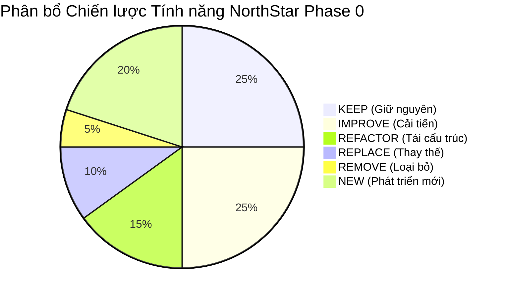

# PHÂN TÍCH KHOẢNG TRỐNG & PHÂN LOẠI DANH MỤC TÍNH NĂNG
## GAP ANALYSIS & FEATURE TAXONOMY REPORT

> **Dự án:** NORTHSTAR – Open-source Emergency Response OS  
> **Mục tiêu:** So sánh hiện trạng sản phẩm với Tầm nhìn Mới, phân loại từng module theo 6 cấp độ chiến lược:  
> **KEEP (Giữ nguyên) | IMPROVE (Cải tiến) | REFACTOR (Tái cấu trúc) | REPLACE (Thay thế) | REMOVE (Loại bỏ) | NEW (Phát triển mới)**.

---

## 1. MA TRẬN PHÂN LOẠI CHI TIẾT (GAP ANALYSIS MATRIX)

---

## 2. CHI TIẾT DANH MỤC VÀ LÝ DO KỸ THUẬT

### 2.1. Nhóm KEEP (Giữ nguyên - Đã hoàn thiện & Đạt chuẩn)
Những thành phần này đã được kiểm thử kỹ lưỡng, vận hành ổn định và giữ vai trò nền tảng:

1. **Thuật toán tìm đường né ngập $A^*$ (`GrassToucher-core/grasstoucher_core/routing.py`)**:
   - *Lý do giữ:* Tốc độ tính toán trung bình 300-400ms, đã được benchmark và kiểm thử tự động, tích hợp trọng số đa thiên tai an toàn.
2. **Thuật toán sơ tán cứu hộ Dijkstra đa nguồn (`find_evacuation_route`)**:
   - *Lý do giữ:* Tự động quét và chọn trạm sơ tán tối ưu còn sức chứa, tính toán khoảng cách né ngập chính xác.
3. **Cơ chế Circuit Breaker CSDL SQLite In-Memory (`app/fallback_storage.py`)**:
   - *Lý do giữ:* Bảo đảm hệ thống máy chủ sống sót 100% khi cơ sở dữ liệu PostgreSQL rớt kết nối hoặc mất điện.
4. **Bộ xử lý Groq Whisper LPU (`transcribe_audio_groq`)**:
   - *Lý do giữ:* Tốc độ giải mã giọng nói siêu tốc (~0.3 giây), độ chính xác tiếng Việt cao.
5. **Bộ tạo báo cáo tác chiến SitRep QĐ 18/2021/QĐ-TTg (`app/routers/sitrep.py`)**:
   - *Lý do giữ:* Đạt chuẩn nghiệp vụ chỉ huy phòng chống thiên tai quốc gia.

---

### 2.2. Nhóm IMPROVE (Cải tiến & Nâng cấp)
Những tính năng đang hoạt động tốt nhưng cần nâng cấp thêm để đáp ứng yêu cầu cứu nạn chuyên nghiệp:

1. **Cấp cứu bằng giọng nói (Voice SOS)**:
   - *Hiện trạng:* Đã có khung sửa văn bản và bóc tách tọa độ địa danh.
   - *Cải tiến:* Bổ sung cơ chế tạo mã theo dõi `Tracking Code` (VD: `SOS-7821`) ngay sau khi gửi để nạn nhân có thể tra cứu tiến độ cứu hộ từ bất kỳ máy nào mà không cần đăng nhập.
2. **Bộ nhớ đệm PWA Service Worker (`sw.js`)**:
   - *Hiện trạng:* Mới chỉ lưu đệm các tệp tĩnh (HTML, CSS, JS).
   - *Cải tiến:* Tích hợp bộ đệm lưu trước mảnh bản đồ ngoại tuyến (Offline Map Tiles Cache via IndexedDB) trong bán kính 10km quanh vị trí cứu hộ.
3. **Hệ thống cảnh báo WebSocket (`websocket_nav.py`)**:
   - *Hiện trạng:* Phát sóng broadcast cho tất cả client kết nối.
   - *Cải tiến:* Bổ sung kênh phân luồng (Channel-based WebSockets): Kênh chung cho người dân, kênh mã hóa chuyên dụng cho Đội cứu hộ và Kênh Tác chiến cho Chỉ huy.
4. **Mô hình dự báo mực nước dâng AI Scikit-learn (`prediction_engine.py`)**:
   - *Hiện trạng:* Huấn luyện trên 8 điểm ngập mẫu Hà Nội.
   - *Cải tiến:* Chuẩn hóa dữ liệu đầu vào nạp trực tiếp lượng mưa vệ tinh NASA GPM và lưu lượng dòng chảy sông ngòi GloFAS.

---

### 2.3. Nhóm REFACTOR (Tái cấu trúc lại mã nguồn)
Tổ chức lại kiến trúc để đáp ứng khả năng mở rộng (Scalability) và bảo trì lâu dài:

1. **Cấu trúc Giao diện Đơn thể (Monolithic UI Split)**:
   - *Hiện trạng:* Một tệp `index.html` duy nhất (hơn 1,900 dòng) chứa toàn bộ chức năng của cả người dân, đội cứu hộ và ban chỉ huy.
   - *Tái cấu trúc:* Tách bạch rõ ràng thành **3 Cổng tương tác (Portals)**:
     - `portal-citizen/`: Giao diện tinh gọn cho Người dân (SOS, Báo cáo, Tra cứu vùng an toàn).
     - `portal-rescuer/`: Giao diện chuyên nghiệp cho Đội cứu hộ (Nhiệm vụ, Điều hướng hiện trường, Trạng thái xuồng).
     - `portal-command/`: Bảng điều khiển tác chiến tổng thể cho Ban chỉ huy (COP, Phân bổ nguồn lực, SitRep).
2. **Kiến trúc Router Backend theo Hướng Miền (Domain-Driven Routers)**:
   - *Hiện trạng:* Một số router gộp chung logic (như `ai_endpoints.py` vừa xử lý Voice SOS, vừa xử lý chat, vừa tạo beacon).
   - *Tái cấu trúc:* Tách thành các miền nghiệp vụ rõ rệt: `routers/citizen/`, `routers/rescuer/`, `routers/command/`, `routers/gis/`.

---

### 2.4. Nhóm REPLACE (Thay thế bằng giải pháp mới vượt trội)

1. **Thay thế toàn bộ các nguồn dữ liệu cào web cũ (Web Scraping)**:
   - *Hiện trạng:* Các đoạn mã hoặc ý tưởng cào từ `nchmf.gov.vn` gây rủi ro pháp lý và kỹ thuật.
   - *Thay thế:* Thay thế triệt để bằng bộ 4 chuẩn mở quốc tế: **Open-Meteo API** (CC-BY 4.0), **Copernicus GloFAS** (Open Access), **NASA GPM IMERG** (Public Domain), và **OpenStreetMap** (ODbL 1.0).
2. **Thay thế cơ chế Geolocation trình duyệt mặc định**:
   - *Hiện trạng:* Lấy IP mạng gây lệch vị trí người phát tín hiệu cứu hộ.
   - *Thay thế:* Bộ giải pháp **Định vị Đa tầng (Multi-Tier Location Resolver)**: Tự động nắn tọa độ theo địa danh giọng nói + Cho phép nạn nhân chấm trực tiếp mái nhà trên bản đồ Leaflet.

---

### 2.5. Nhóm REMOVE (Loại bỏ các thành phần rác & dư thừa)

1. **Các endpoint mock thử nghiệm không dùng**:
   - Loại bỏ các đường dẫn thử nghiệm cũ không tuân thủ chuẩn Pydantic schema v2.
2. **Các tham chiếu tài nguyên thừa**:
   - Dọn dẹp các tệp ảnh/tài nguyên tĩnh tạm thời không còn sử dụng trong thư mục mã nguồn để giảm dung lượng gói cài đặt.

---

### 2.6. Nhóm NEW (Các chức năng Bổ sung Mới theo Tầm nhìn OS)
Đây là các chức năng mang tính quyết định để nâng tầm NORTHSTAR thành một Hệ điều hành Cứu nạn hoàn chỉnh:

| Chức năng Mới | Phân hệ Phụ trách | Mô tả Nghiệp vụ Chi tiết |
| :--- | :--- | :--- |
| **Quản lý Đội Cứu hộ (Rescue Teams)** | Backend & Rescue Portal | Quản lý danh sách đội cứu hộ (114, Quân sự, CLB Xuồng hơi), người phụ trách, số điện thoại hotline, trạng thái trực chiến (Sẵn sàng / Đang làm nhiệm vụ / Nghỉ ngơi). |
| **Phân công & Tiếp nhận Nhiệm vụ (Task Assignment)** | Command & Rescue Portal | Chỉ huy phân công ca SOS cho đội cứu hộ cụ thể; Đội cứu hộ nhận thông báo âm thanh, bấm "Tiếp nhận" hoặc "Từ chối" kèm lý do. |
| **Quản lý Phương tiện & Tài sản (Asset Management)** | Command Center | Quản lý số lượng xuồng máy, ca-nô, xe tải gầm cao, phao cứu sinh, flycam tìm kiếm. Theo dõi vị trí phương tiện thời gian thực. |
| **Quản lý Kho vận & Nhu yếu phẩm (Supply Inventory)** | Command Center | Thống kê số lượng mì tôm, nước đóng chai, áo phao, túi sơ cứu y tế tại từng trạm sơ tán để điều phối tiếp tế chống thiếu hụt cục bộ. |
| **Hàng đợi Đồng bộ Ngoại tuyến (SyncQueue)** | Frontend PWA & Backend | Khi mất mạng hoàn toàn, các hành động của đội cứu hộ được ghi vào hàng đợi `IndexedDB`. Khi phát hiện có kết nối, tự động gửi batch đồng bộ có gắn dấu thời gian (Timestamp Vector). |
| **Xác thực & Phân quyền Vai trò (RBAC Auth)** | Toàn hệ thống | Quản lý người dùng theo vai trò: `Citizen` (Không cần login), `Rescuer` (Xác thực đội), `Commander` (Toàn quyền tác chiến). |
