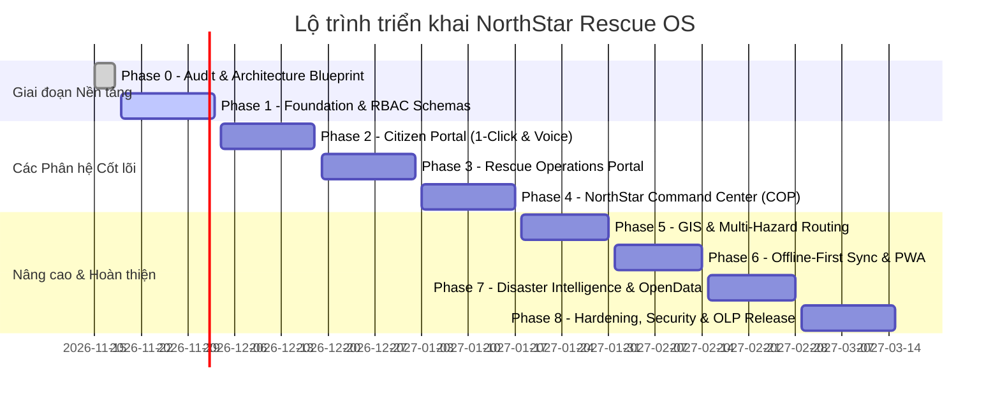

# KẾ HOẠCH TRIỂN KHAI VÀ LỘ TRÌNH PHÁT TRIỂN (IMPLEMENTATION ROADMAP)
## Dự án: NORTHSTAR – Open-source Emergency Response & Rescue Coordination OS
**Mô hình nhân sự tinh gọn:** Đội ngũ 1 – 3 kỹ sư (Dev 1: Tech Lead/Fullstack; Dev 2: Backend/GIS & Data; Dev 3: Frontend/PWA & UX)  
**Thời gian chu kỳ:** 8 Giai đoạn triển khai tuần tự theo chiến lược lặp gia tăng (Iterative Incremental)

---

## 1. TỔNG QUAN PHÂN KỲ DỰ ÁN

---

## 2. CHI TIẾT CÁC GIAI ĐOẠN TRIỂN KHAI (PHASES 1 - 8)

### Phase 1: Foundation & RBAC Schemas (Hạ tầng, Xác thực & Mô hình Dữ liệu)
- **Mục tiêu:** Thiết lập cấu trúc cơ sở dữ liệu PostgreSQL/PostGIS chuẩn xác theo `DATABASE_DESIGN.md`, tích hợp cơ chế RBAC (`SYSTEM_ADMIN`, `COMMANDER`, `DISPATCHER`, `RESCUER`, `CITIZEN`), quản lý multi-tenant organizations và hệ thống migration tự động Alembic.
- **Repositories liên quan:**
  - `GrassToucher-backend`: Migration Alembic, models SQLAlchemy, auth router (JWT token, password hashing, role guard dependency).
- **Files chính cần tạo / chỉnh sửa:**
  - `GrassToucher-backend/alembic.ini` & `GrassToucher-backend/alembic/versions/*`
  - `GrassToucher-backend/app/models/entities.py` (Khai báo 12 bảng thực thể)
  - `GrassToucher-backend/app/core/security.py` (JWT, bcrypt, RBAC dependency `require_role`)
  - `GrassToucher-backend/app/routers/auth.py` (`/api/v1/auth/register`, `/api/v1/auth/login`, `/api/v1/auth/me`)
- **Tiêu chí hoàn thành (Acceptance Criteria):**
  - Chạy `alembic upgrade head` tạo thành công 12 bảng dữ liệu và 10 enum types trong cơ sở dữ liệu.
  - Test suite API Auth đạt 100% pass: Đăng ký, đăng nhập cấp Bearer Token, kiểm tra quyền truy cập theo từng Role.
  - Dự phòng Circuit Breaker SQLite vẫn chạy trơn tru khi môi trường không có PostgreSQL.
- **Phụ thuộc:** `docs/DATABASE_DESIGN.md`.
- **Phân bổ nhân sự (Đội 3 người):**
  - **Dev 1:** Thiết kế JWT security middleware, RBAC dependencies, integration testing.
  - **Dev 2:** Viết DDL SQLAlchemy models, Alembic migrations, database seeders dữ liệu mẫu.
  - **Dev 3:** Chuẩn bị auth client store trên frontend (`localStorage` token management, route guards).

---

### Phase 2: Citizen Portal (SOS Khẩn Cấp, Báo Cáo Hiện Trường & Tra Cứu)
- **Mục tiêu:** Xây dựng cổng thông tin dân sự tối giản, cho phép người dân gửi yêu cầu cứu hộ tức thì (1-Click & Voice SOS) không cần đăng nhập bắt buộc, gửi bằng chứng ảnh, và tra cứu trạng thái qua `tracking_code`.
- **Repositories liên quan:**
  - `GrassToucher-backend`: API endpoints cho Citizen SOS, geocoding từ ngữ giọng nói, upload đa phương tiện.
  - `GrassTouchers-Frontend`: Giao diện Cổng Người Dân chuyên dụng, tối ưu hóa giao diện di động.
- **Files chính cần tạo / chỉnh sửa:**
  - `GrassToucher-backend/app/routers/citizen.py` (`POST /sos`, `GET /sos/track/{code}`, `POST /reports`)
  - `GrassTouchers-Frontend/portal-citizen.html` (Giao diện độc lập cho người dân)
  - `GrassTouchers-Frontend/js/citizen_sos.js` (Xử lý 1-click SOS, tracking modal, định vị GPS vệ tinh)
  - `GrassTouchers-Frontend/js/voice_sos.js` (Tích hợp Whisper/Groq API kèm textarea xem lại trước khi gửi)
- **Tiêu chí hoàn thành (Acceptance Criteria):**
  - Người dân chỉ mất tối đa 2 thao tác (hoặc 1 câu nói) để tạo thành công yêu cầu SOS có toạ độ GPS chính xác.
  - Hệ thống tự sinh mã theo dõi (ví dụ: `SOS-2026-8842`) cho phép tra cứu trạng thái nhiệm vụ mà không để lộ số điện thoại nạn nhân.
  - Tải ảnh hiện trường tối ưu dung lượng (nén client-side xuống < 500KB trước khi upload).
- **Phụ thuộc:** Phase 1.
- **Phân bổ nhân sự:**
  - **Dev 1:** API upload media, rate-limiting chống spam báo cáo ảo (Redis/In-memory bucket).
  - **Dev 2:** Tinh chỉnh parser giọng nói tiếng Việt chuyên ngành thiên tai (Whisper prompting).
  - **Dev 3:** Toàn bộ UI/UX Cổng Người Dân, responsive di động, hiển thị mã theo dõi và modal safe zone.

---

### Phase 3: Rescue Operations Portal (Cổng Tác Nghiệp Đội Cứu Hộ)
- **Mục tiêu:** Cung cấp công cụ tác nghiệp hiện trường cho các chiến sĩ cứu hộ: nhận nhiệm vụ được phân công, cập nhật trạng thái nhiệm vụ (`EN_ROUTE`, `ON_SCENE`, `COMPLETED`), theo dõi dung lượng pin/thiết bị, và xem bản đồ chỉ dẫn an toàn.
- **Repositories liên quan:**
  - `GrassToucher-backend`: Rescue Task APIs, team check-in, tracking toạ độ đội cứu hộ.
  - `GrassTouchers-Frontend`: Giao diện Cổng Đội Cứu Hộ (`portal-rescue.html`), Dark Mode quân sự chống chói, nút bấm ngoại cỡ dễ thao tác khi găng tay ướt.
- **Files chính cần tạo / chỉnh sửa:**
  - `GrassToucher-backend/app/routers/rescue.py` (`/api/v1/rescue/tasks`, `/status`, `/checkin`)
  - `GrassTouchers-Frontend/portal-rescue.html`
  - `GrassTouchers-Frontend/js/rescue_ops.js` (Quản lý danh sách ca cứu hộ, bảng phân công)
  - `GrassTouchers-Frontend/js/tactical_map.js` (Bản đồ tác chiến hiển thị điểm nạn nhân, độ sâu ngập)
- **Tiêu chí hoàn thành (Acceptance Criteria):**
  - Đội cứu hộ đăng nhập bằng tài khoản RESCUER chỉ thấy các nhiệm vụ thuộc địa bàn được phân quyền.
  - Chuyển đổi trạng thái nhiệm vụ phản hồi tức thời lên WebSocket trung tâm điều hành < 1s.
  - Giao diện có chế độ tương phản cao, thao tác được bằng một tay khi đang trên xuồng cứu sinh.
- **Phụ thuộc:** Phase 1, Phase 2.
- **Phân bổ nhân sự:**
  - **Dev 1:** WebSocket Gateway thông báo nhiệm vụ thời gian thực (`/ws/rescue/{team_id}`).
  - **Dev 2:** Logic phân luồng dữ liệu bảo mật (Row-Level Security dựa trên `team_id` và `organization_id`).
  - **Dev 3:** Giao diện tác nghiệp hiện trường, tactical map với các icon phân loại phương tiện (xuồng, cano, xe lội nước).

---

### Phase 4: NorthStar Command Center (Trung Tâm Chỉ Huy COP & Điều Phối)
- **Mục tiêu:** Xây dựng bức tranh tác chiến toàn cảnh (Common Operating Picture - COP) cho Trung tâm điều hành: phân loại ưu tiên tự động (Triage P1-P4), gom nhóm trùng lặp không gian/thời gian, phân công đội cứu hộ, quản lý kho vật tư và xuất báo cáo SitRep (Quyết định 18/2021/QĐ-TTg).
- **Repositories liên quan:**
  - `GrassToucher-backend`: Dispatching API, Triage Engine, Deduplication Service, Inventory API.
  - `GrassTouchers-Frontend`: Command Dashboard (`portal-command.html`), Multi-screen monitoring, Live GIS Heatmaps.
- **Files chính cần tạo / chỉnh sửa:**
  - `GrassToucher-backend/app/services/triage_service.py` (Thuật toán chấm điểm khẩn cấp P1-P4)
  - `GrassToucher-backend/app/services/dedup_service.py` (Spatiotemporal clustering bán kính 50m / 30 phút)
  - `GrassToucher-backend/app/routers/command.py` (`/triage`, `/dispatch`, `/inventory`, `/sitrep`)
  - `GrassTouchers-Frontend/portal-command.html` & `GrassTouchers-Frontend/js/command_cop.js`
- **Tiêu chí hoàn thành (Acceptance Criteria):**
  - Tự động nhận diện và đánh dấu cảnh báo trùng lặp khi có từ 2 báo cáo trở lên trong cùng bán kính 50m trong 30 phút.
  - Phân loại chính xác 100% ca nguy cấp có trẻ nhỏ/người già bị nước ngập lên nóc nhà vào nhóm P1 (CRITICAL).
  - Xuất báo cáo SitRep tự động định dạng Markdown/PDF chỉ với 1 cú click chuột.
- **Phụ thuộc:** Phase 1, Phase 2, Phase 3.
- **Phân bổ nhân sự:**
  - **Dev 1:** Xây dựng Triage Engine, Dedup Clustering Service, WebSocket broadcasting.
  - **Dev 2:** Module quản lý kho vật tư cứu trợ (Supply Inventory) và generator SitRep chuẩn quy định Việt Nam.
  - **Dev 3:** Xây dựng Command COP Dashboard với Leaflet MarkerCluster, split panel điều động.

---

### Phase 5: GIS & Multi-Hazard Routing Engine (Định Tuyến Cứu Hộ Đa Hiểm Họa)
- **Mục tiêu:** Nâng cấp thuật toán A* và Dijkstra trong `GrassToucher-core` để tính toán tuyến đường cứu hộ tối ưu vượt qua các chướng ngại địa hình: ngập nước, sạt lở taluy, cầu yếu, kết hợp dữ liệu cao độ DEM và đặc tính phương tiện (đi bộ, xe tải gầm cao, xuồng cứu sinh).
- **Repositories liên quan:**
  - `GrassToucher-core`: Graph processing, Multi-hazard cost function, A*/Dijkstra solver.
  - `GrassToucher-backend`: GIS routing proxy, GeoJSON layer formatting.
  - `GrassTouchers-Frontend`: Visualizer lộ trình cứu hộ, profile phương tiện cứu nạn.
- **Files chính cần tạo / chỉnh sửa:**
  - `GrassToucher-core/grasstoucher/routing/risk_cost_function.py`
  - `GrassToucher-core/grasstoucher/routing/multimodal_router.py` (Xe gầm cao vs Xuồng vs Đi bộ)
  - `GrassToucher-backend/app/routers/routing.py` (Mở rộng `/api/v1/routing/rescue-path`)
  - `GrassTouchers-Frontend/js/route_planner.js`
- **Tiêu chí hoàn thành (Acceptance Criteria):**
  - Lộ trình đề xuất tự động tránh các điểm ngập vượt quá giới hạn an toàn của phương tiện (ví dụ: xe cứu thương tránh điểm ngập > 20cm; xuồng cứu sinh tránh đường cạn).
  - Luôn trả về cảnh báo `CONFIDENCE_LEVEL` nếu đoạn đường chưa có xác minh thực địa từ chốt cứu hộ.
  - Tốc độ tính toán tuyến đường trong đồ thị đô thị bán kính 20km < 800ms.
- **Phụ thuộc:** `GrassToucher-core` hiện tại.
- **Phân bổ nhân sự:**
  - **Dev 1:** Kết nối API định tuyến từ core sang backend, tích hợp cache Redis đồ thị đường sắt/bộ.
  - **Dev 2:** Nâng cấp hàm trọng số A* tích hợp rủi ro ngập và độ dốc taluy trong `GrassToucher-core`.
  - **Dev 3:** Vẽ tuyến đường trên Leaflet kèm cảnh báo mặt đường theo màu (Xanh: An toàn, Vàng: Ngập nhẹ, Đỏ: Cấm qua).

---

### Phase 6: Offline-First Synchronization & PWA (Đồng Bộ Ngoại Tuyến Toàn Diện)
- **Mục tiêu:** Triển khai cơ chế hoạt động ngoại tuyến thực tế theo `OFFLINE_FIRST_DESIGN.md`: Lưu trữ hàng đợi IndexedDB `sync_queue` ở client, Service Worker caching bản đồ vector/raster MBTiles cục bộ, xử lý xung đột CRDT Last-Write-Wins, và 4 trạng thái minh bạch UX (`SAVED_LOCAL` -> `QUEUED` -> `SENT` -> `SYNCED`).
- **Repositories liên quan:**
  - `GrassTouchers-Frontend`: Service Worker PWA, IndexedDB wrapper, SyncQueue manager.
  - `GrassToucher-backend`: Endpoint `/api/v1/sync/batch`, cơ chế đối soát `client_uuid` và `version`.
- **Files chính cần tạo / chỉnh sửa:**
  - `GrassTouchers-Frontend/service-worker.js` (Cache API chiến lược Cache-First cho tiles và app shell)
  - `GrassTouchers-Frontend/js/offline_sync.js` (IndexedDB schema, retry exponential backoff)
  - `GrassToucher-backend/app/routers/sync.py` (Batch ingestion, conflict reconciliation)
- **Tiêu chí hoàn thành (Acceptance Criteria):**
  - Khi ngắt kết nối Internet hoàn toàn, người dân và cứu hộ vẫn nhập được báo cáo, ứng dụng hiển thị rõ ràng huy hiệu vàng: *"Đã lưu cục bộ trên máy - Sẵn sàng gửi khi có sóng"*.
  - Khi bật lại kết nối, hệ thống tự động đẩy hàng đợi lên server trong vòng 5 giây không cần người dùng thao tác lại.
  - Không bao giờ để mất mát dữ liệu báo cáo đã nhập ở máy khách.
- **Phụ thuộc:** Phase 2, Phase 3, `docs/OFFLINE_FIRST_DESIGN.md`.
- **Phân bổ nhân sự:**
  - **Dev 1:** API Batch Ingestion, idempotency key chống nhân đôi bản ghi.
  - **Dev 2:** Định dạng và nén gói tin ngoại tuyến (JSON compression / Protobuf).
  - **Dev 3:** Xây dựng Service Worker, IndexedDB SyncQueue, UX indicator trạng thái mạng.

---

### Phase 7: Disaster Intelligence & Open Data Integration (Tình Báo Thiên Tai Dữ Liệu Mở)
- **Mục tiêu:** Tích hợp các nguồn dữ liệu mở toàn cầu không cần cào web (Zero Web Scraping) tuân thủ `DATA_SOURCES.md`: Open-Meteo API (mưa/gió thời gian thực), GloFAS (dự báo lũ lưu vực sông Hồng/Mê Kông), NASA GPM (vệ tinh mưa diện rộng), và phân tích ranh giới lưu vực HydroSHEDS.
- **Repositories liên quan:**
  - `GrassToucher-core`: Data collectors cho Open-Meteo, GloFAS, GPM.
  - `GrassToucher-backend`: Scheduled background tasks fetch dữ liệu, cảnh báo sớm.
  - `GrassTouchers-Frontend`: Lớp phủ thời tiết khí tượng trực quan (Radar mưa, Heatmap nguy cơ).
- **Files chính cần tạo / chỉnh sửa:**
  - `GrassToucher-core/grasstoucher/data/open_meteo_client.py`
  - `GrassToucher-core/grasstoucher/data/glofas_client.py`
  - `GrassToucher-backend/app/tasks/disaster_monitor.py` (APScheduler / Celery background job)
  - `GrassTouchers-Frontend/js/disaster_layers.js`
- **Tiêu chí hoàn thành (Acceptance Criteria):**
  - 100% dữ liệu thời tiết và thủy văn được lấy từ API chính thống có giấy phép mở rõ ràng (ODbL, CC-BY, Open Data).
  - Hoàn toàn loại bỏ mã nguồn cào HTML từ các trang web nội bộ đóng.
  - Hiển thị dự báo lượng mưa 24h tới tại từng huyện/thị xã với sai số thời gian cập nhật < 1 giờ.
- **Phụ thuộc:** `GrassToucher-core`.
- **Phân bổ nhân sự:**
  - **Dev 1:** Thiết lập pipeline ETL đồng bộ dữ liệu thời tiết nền, thiết lập caching Redis tránh vượt quota API mở.
  - **Dev 2:** Xây dựng adapter kết nối Open-Meteo và GloFAS, chuẩn hóa GeoJSON trả về cho GIS.
  - **Dev 3:** Render lớp phủ Radar lượng mưa và lưu vực ngập trên Leaflet.

---

### Phase 8: Hardening, Security, E2E Testing & OLP 2026 Release (Hoàn Thiện, Bảo Mật & Đóng Gói)
- **Mục tiêu:** Kiểm toán an ninh toàn diện (OWASP Top 10, bảo mật thông tin nạn nhân, chống rò rỉ dữ liệu cá nhân PII), hoàn thiện bộ tài liệu mã nguồn mở theo chuẩn GitHub OSS, viết hướng dẫn cài đặt Docker Compose 1-lệnh, kiểm thử E2E kịch bản cứu hộ mô phỏng bão lũ thực tế.
- **Repositories liên quan:** Cả 3 repositories (`core`, `backend`, `frontend`).
- **Files chính cần tạo / chỉnh sửa:**
  - `docker-compose.yml` (Khởi chạy trọn bộ: PostgreSQL/PostGIS, Redis, Backend, Frontend Nginx)
  - `.github/workflows/ci.yml` (CI chạy tự động linting, unit test, build docker image)
  - `SECURITY.md`, `CONTRIBUTING.md`, `README.md` (Tài liệu định vị thương hiệu NorthStar OS)
  - `tests/e2e/test_rescue_lifecycle.py` (Kịch bản cứu nạn khép kín từ SOS đến Hoàn thành)
- **Tiêu chí hoàn thành (Acceptance Criteria):**
  - Hệ thống khởi động thành công trên máy tính mới chỉ với `docker compose up -d`.
  - Bộ kiểm thử đạt > 90% code coverage cho luồng SOS khẩn cấp và điều phối cứu hộ.
  - 100% tài liệu kiến trúc, API docs và giấy phép mở đạt tiêu chuẩn tham dự Hội thi Olympic Tin học Sinh viên / Phần mềm Nguồn Mở 2026.
- **Phân bổ nhân sự:** Cả 3 thành viên tham gia rà soát chéo (Cross-review), pentest bảo mật, và hoàn thiện demo presentation.

---

## 3. MA TRẬN PHÂN BỔ NHÂN LỰC TINH GỌN (1 - 3 THÀNH VIÊN)

| Vai trò / Thành viên | Trọng tâm phụ trách | Nhiệm vụ chính trong 8 Phase |
| :--- | :--- | :--- |
| **Dev 1: Tech Lead / Fullstack** | Kiến trúc hệ thống, Security, Realtime & Điều phối | - Thiết kế Auth/RBAC, WebSocket Gateway - Thuật toán Triage SOS & Gom nhóm trùng lặp - Quản lý CI/CD, Docker Compose và bảo mật API |
| **Dev 2: Backend, GIS & Data** | GIS Routing, Data Pipelines & CSDL | - Xây dựng DDL Database PostGIS & Alembic Migrations - Tối ưu hóa thuật toán A* / Dijkstra đa hiểm họa (`core`) - Tích hợp Open Data (Open-Meteo, GloFAS) & Báo cáo SitRep |
| **Dev 3: Frontend, PWA & UX** | Giao diện 3 Cổng, PWA Offline-First & Bản đồ tác chiến | - Xây dựng 3 giao diện riêng biệt: Citizen, Rescue, Command - Hiện thực IndexedDB SyncQueue và PWA Service Worker - Bản đồ tương tác Leaflet: Triage heatmaps, tactical layers |

---

## 4. CHIẾN LƯỢC QUẢN TRỊ RỦI RO & DỰ PHÒNG

| Rủi ro kỹ thuật | Mức độ | Biện pháp giảm thiểu & Thiết kế dự phòng |
| :--- | :---: | :--- |
| Mất kết nối Internet tại vùng rốn lũ | **CRITICAL** | Chế độ Offline-First với IndexedDB + Service Worker. Hệ thống không bao giờ báo "Đã gửi thành công" nếu chưa có ACK từ máy chủ. Dự phòng mô hình LoRa / Radio packet trong tương lai. |
| Quá tải số lượng yêu cầu SOS ảo / Spam | **HIGH** | Rate-limiting theo IP/Thiết bị, gom nhóm tự động theo tọa độ không gian (50m) và thời gian (30m), bộ lọc trùng lặp Deduplication Service. |
| Thiếu hụt cơ sở dữ liệu PostgreSQL ở môi trường tối giản | **MEDIUM** | Duy trì Circuit Breaker: Tự động lùi về SQLite cục bộ cho các máy trạm tiền phương độc lập. |
| Hết hạn mức hoặc trễ mạng từ AI Cloud (Groq) | **MEDIUM** | Tự động chuyển đổi Fallback: Speech recognition trên trình duyệt (Web Speech API) + Cung cấp form nhập tay và pin map trực quan. |

---

## 5. TỔNG KẾT
Lộ trình 8 Phase trên bảo đảm tính khả thi tuyệt đối cho một nhóm nghiên cứu nhỏ (1 - 3 người), biến dự án từ một ứng dụng xem ngập đơn lẻ thành **Hệ điều hành ứng phó khẩn cấp và điều phối cứu hộ nguồn mở NORTHSTAR** đạt chuẩn công nghiệp, sẵn sàng triển khai thực chiến.
