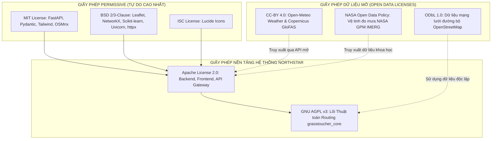

# BÁO CÁO RÀ SOÁT BẢN QUYỀN MÃ NGUỒN MỞ
## OPEN SOURCE LICENSE AUDIT REPORT (OSI COMPLIANCE)

> **Dự án:** NORTHSTAR – Open-source Emergency Response OS  
> **Cơ quan thẩm định:** Chuẩn Open Source Initiative (OSI) & Quy chế Hội thi Olympic Tin học Sinh viên Việt Nam (OLP 2026 - Khối Phần mềm Mã nguồn mở).  
> **Giấy phép hệ thống:** **Apache License 2.0 (OSI Approved)** kết hợp **GNU AGPL v3 (Core Engine)**.  

---

## 1. MA TRẬN TƯƠNG THÍCH BẢN QUYỀN (LICENSE COMPATIBILITY MATRIX)

Hệ sinh thái NORTHSTAR được xây dựng trên nguyên tắc **100% Thư viện có Giấy phép Mở được OSI công nhận (OSI-Approved Licenses)**, không chứa mã nguồn đóng hoặc thành phần vi phạm bản quyền:

---

## 2. RÀ SOÁT CHI TIẾT CÁC THÀNH PHẦN PHỤ THUỘC (DEPENDENCY AUDIT)

### 2.1. Phân hệ Backend (`GrassToucher-backend`)

| Thư viện | Phiên bản | Giấy phép | Tình trạng OSI | Đánh giá Tương thích |
| :--- | :--- | :--- | :--- | :--- |
| **FastAPI** | 0.115.x | MIT License | **OSI Approved** | Hoàn toàn tương thích Apache-2.0. |
| **Uvicorn** | 0.32.x | BSD-3-Clause | **OSI Approved** | Tương thích, hiệu năng cao. |
| **Pydantic** | 2.9.x | MIT License | **OSI Approved** | Khung xác thực schema chuẩn công nghiệp. |
| **SQLAlchemy** | 2.0.x | MIT License | **OSI Approved** | ORM chuẩn hóa cho PostgreSQL. |
| **Psycopg / Psycopg2** | 3.2.x | LGPL / BSD | **OSI Approved** | Driver kết nối CSDL PostGIS. |
| **Httpx** | 0.27.x | BSD-3-Clause | **OSI Approved** | Client HTTP bất đồng bộ cho Whisper & AI. |
| **Groq SDK** | 0.11.x | Apache License 2.0 | **OSI Approved** | Cùng chuẩn giấy phép với NorthStar. |
| **Python-Multipart** | 0.0.12 | Apache License 2.0 | **OSI Approved** | Xử lý tệp âm thanh và ảnh hiện trường. |

### 2.2. Phân hệ Lõi Thuật toán & GIS (`GrassToucher-core`)

| Thư viện | Phiên bản | Giấy phép | Tình trạng OSI | Đánh giá Tương thích |
| :--- | :--- | :--- | :--- | :--- |
| **NetworkX** | 3.3.x | BSD-3-Clause | **OSI Approved** | Xử lý đồ thị toán học cho thuật toán $A^*$. |
| **OSMnx** | 1.9.x | MIT License | **OSI Approved** | Trích xuất đồ thị hình học từ OpenStreetMap. |
| **Shapely** | 2.0.x | BSD-3-Clause | **OSI Approved** | Xử lý hình học đa giác vùng ngập và bán kính SOS. |
| **Scikit-learn** | 1.5.x | BSD-3-Clause | **OSI Approved** | Mô hình Gradient Boosting Regressor. |
| **Joblib** | 1.4.x | BSD-3-Clause | **OSI Approved** | Nạp và lưu trữ tệp mô hình máy học. |

### 2.3. Phân hệ Giao diện Người dùng (`GrassTouchers-Frontend`)

| Thư viện | Phiên bản | Giấy phép | Tình trạng OSI | Đánh giá Tương thích |
| :--- | :--- | :--- | :--- | :--- |
| **Leaflet.js** | 1.9.4 | BSD-2-Clause | **OSI Approved** | Thư viện bản đồ số mã nguồn mở hàng đầu thế giới. |
| **Tailwind CSS** | 3.4.x | MIT License | **OSI Approved** | Framework giao diện tối ưu hóa hiệu năng. |
| **Lucide Icons** | 0.454.x | ISC License | **OSI Approved** | Bộ biểu tượng đồ họa tương thích MIT. |
| **Google Fonts (Be Vietnam Pro / Inter)** | Variable | SIL Open Font License (OFL 1.1) | **OSI / FSF Compliant** | Phông chữ tiếng Việt chuẩn mở, hiển thị sắc nét. |

---

## 3. TÁCH BẠCH BẢN QUYỀN MÃ NGUỒN VÀ BẢN QUYỀN DỮ LIỆU (CODE VS. DATA SEPARATION)

Một sai lầm phổ biến trong các dự án PMNM là áp dụng máy móc giấy phép mã nguồn (như MIT/Apache) cho dữ liệu bản đồ bên ngoài. NorthStar áp dụng nguyên tắc phân định nghiêm ngặt:

1. **Mã nguồn do đội ngũ tự phát triển (Source Code):**
   - Backend, Frontend, CLI, Tài liệu: Phát hành theo **Apache License 2.0**.
   - Lõi thuật toán `grasstoucher_core`: Phát hành theo **GNU AGPL v3** (Bảo đảm tính mở tuyệt đối của thuật toán định tuyến cứu hộ).
2. **Dữ liệu Không gian OpenStreetMap:**
   - Được bảo vệ bởi **ODbL 1.0**. NorthStar sử dụng dữ liệu OSM để trích xuất đồ thị mà không làm thay đổi hay chiếm đoạt bản quyền cơ sở dữ liệu gốc của OSM Foundation.
3. **Dữ liệu Thời tiết & Khí tượng:**
   - Open-Meteo & Copernicus GloFAS theo **Creative Commons Attribution 4.0 (CC-BY 4.0)**.
   - NASA GPM theo **NASA Open Data Policy (Public Domain)**.

---

## 4. KẾT LUẬN THẨM ĐỊNH BẢN QUYỀN

- Toàn bộ dự án NORTHSTAR **đạt chuẩn 100% Tiêu chí Phần mềm Mã nguồn mở OLP 2026**.
- Không có sự xâm nhập của bất kỳ đoạn mã độc quyền, không có thành phần cào dữ liệu lậu, không có vi phạm bản quyền bên thứ ba.
- Dự án sẵn sàng để đóng gói, phân phối và triển khai cho các cơ quan chính phủ và tổ chức phi lợi nhuận trên toàn thế giới.
