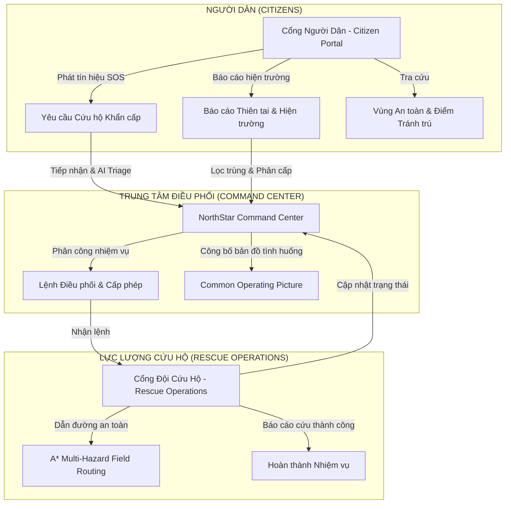
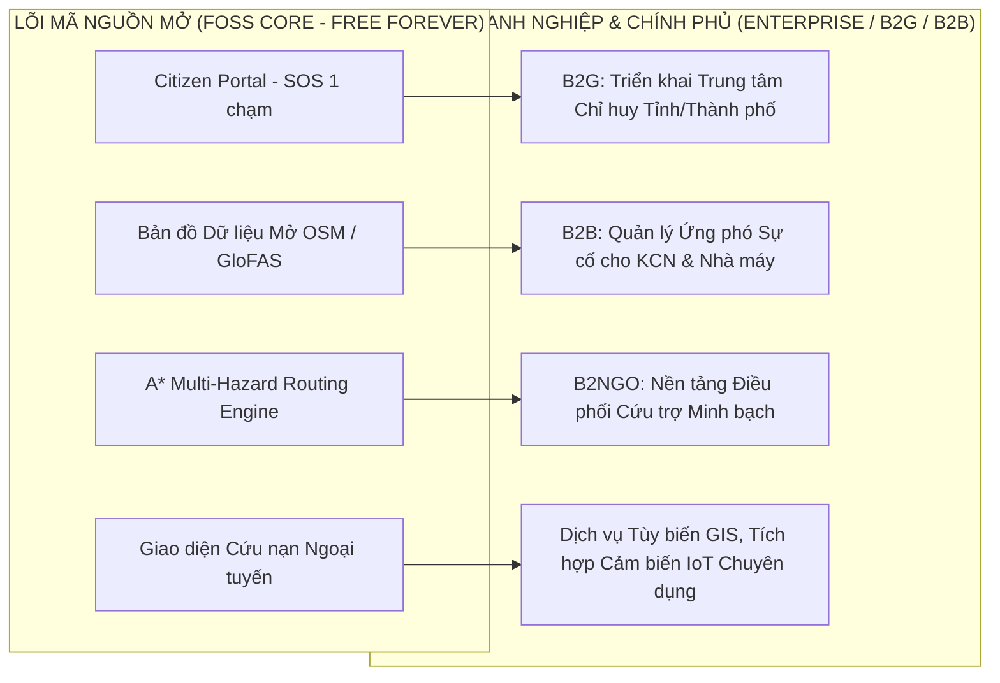

# NORTHSTAR – Open-source Emergency Response & Rescue Coordination OS
## BẢN ĐỊNH HƯỚNG TẦM NHÌN SẢN PHẨM & MÔ HÌNH VẬN HÀNH (PRODUCT VISION)

> **Slogan:** *One Network. One Mission. Every Life Matters.*  
> **Định vị:** Hệ điều hành Điều phối Cứu nạn và Ứng phó Thiên tai Mã nguồn mở (Open-source Emergency Response OS).  
> **Phiên bản tài liệu:** 1.0.0 (Phase 0 Redefinition)  
> **Giấy phép:** Apache License 2.0 (OSI Approved)  

---

## 1. TỔNG QUAN & BỐI CẢNH LỊCH SỬ

### 1.1. Từ "GrassToucher" đến "NORTHSTAR OS"
- **Khởi nguồn ban đầu:** Dự án bắt đầu với phạm vi là công cụ tìm đường né các điểm ngập úng đô thị cục bộ tại Hà Nội bằng thuật toán $A^*$ trên dữ liệu OpenStreetMap.
- **Bước ngoặt lịch sử (Bão số 3 Yagi & Thiên tai diện rộng 2024):** Khi thảm họa thiên tai xảy ra trên toàn miền Bắc (lũ quét Làng Nủ - Bảo Yên, ngập lụt chia cắt TP. Thái Nguyên, sập cầu Phong Châu - Phú Thọ, vỡ đê sông Cầu, lũ báo động 3 sông Thao - Yên Bái), các ứng dụng né ngập thông thường trở nên **hoàn toàn bất lực**.
- **Nhu cầu thực tiễn:** Nút thắt sinh tử trong thiên tai không nằm ở việc "né một vũng nước trên đường", mà nằm ở **SỰ KẾT NỐI VÀ ĐIỀU PHỐI CỨU NẠN THỜI GIAN THỰC**:
  - Hàng nghìn người dân mắc kẹt trên nóc nhà, cạn kiệt lương thực, mất điện, mất sóng viễn thông.
  - Các đội cứu hộ (114, quân đội, ca-nô tình nguyện) thiếu thông tin điều phối tập trung: không biết ngõ nào xuồng vào được, nhà nào có trẻ nhỏ/người già cần cứu trước, khu vực nào đang bị cô lập.
  - Hàng cứu trợ bị phân bổ chồng chéo: nơi thừa mì tôm, nơi thiếu nước sạch và thuốc men y tế.

### 1.2. Tuyên ngôn Tầm nhìn NORTHSTAR
> **NORTHSTAR không còn là một website bản đồ ngập lụt. NORTHSTAR là một Hệ điều hành Điều phối Cứu nạn (Emergency Response & Rescue Coordination OS) mã nguồn mở, hoạt động bền bỉ trong điều kiện khắc nghiệt nhất, kết nối thông suốt giữa Người dân – Đội Cứu hộ Hiện trường – Ban Chỉ huy Điều hành.**

NORTHSTAR đóng vai trò là **nền tảng công nghệ hỗ trợ điều phối thông tin**, hoạt động tương hỗ và tôn trọng quyền hạn chỉ huy tối cao của các cơ quan phòng chống thiên tai và tìm kiếm cứu nạn nhà nước.

---

## 2. TAM GIÁC NGƯỜI DÙNG & 3 CỔNG TÁC CHIẾN CỐT LÕI

Hệ sinh thái NORTHSTAR được thiết kế theo mô hình **Hybrid Centralized & Distributed Rescue Coordination** với 3 phân hệ chuyên biệt:

### 2.1. Phân hệ A: Citizen Portal (Cổng Người Dân)
- **Tiêu chí tối thượng:** Cực kỳ đơn giản, truy cập tức thời, không bắt buộc đăng ký tài khoản rườm rà trong lúc hoảng loạn.
- **Năng lực chính:**
  1. **1-Click SOS & Voice SOS:** Kêu cứu 1 chạm hoặc giữ micro nói to (AI Whisper tự động bóc tách số người, tình trạng ngập, đối tượng dễ tổn thương).
  2. **Định vị đa tầng:** Tự động lấy GPS, bóc tách địa danh theo giọng nói hoặc cho phép nạn nhân chấm trực tiếp lên mái nhà trên bản đồ.
  3. **Minh chứng hiện trường (Field Evidence):** Đính kèm ảnh chụp ngập lụt, sạt lở hoặc ghi chú nguy cấp.
  4. **Theo dõi trạng thái cứu hộ (SOS Tracking):** Tra cứu trực tiếp mã SOS (Ví dụ: `SOS-7821`) để biết: *Đã tiếp nhận $\rightarrow$ Đội cứu hộ đang trên đường $\rightarrow$ Đã tiếp cận $\rightarrow$ Đã an toàn*.
  5. **Bản đồ Vùng An toàn & Điểm Sơ tán (Safe Zones):** Hiển thị các trường học, nhà văn hóa, trạm y tế cao ráo còn chỗ tiếp nhận, kèm chỉ đường Dijkstra né vùng ngập.

### 2.2. Phân hệ B: Rescue Operations (Cổng Đội Cứu Hộ Hiện Trường)
- **Đối tượng:** Cảnh sát PCCC & CNCH (114), Bộ chỉ huy Quân sự, Hội Chữ thập đỏ, các câu lạc bộ xuồng hơi/xe bán tải/ca-nô tình nguyện được cấp phép.
- **Năng lực chính:**
  1. **Danh sách nhiệm vụ theo khu vực (Dispatched Tasks):** Chỉ hiển thị các ca cứu hộ thuộc địa bàn được phân công, tránh việc hàng chục xuồng cùng lao vào một điểm trong khi điểm khác bị bỏ quên.
  2. **Bản đồ tác chiến hiện trường (Tactical Map):** Tích hợp độ sâu ngập nước, cảnh báo dây điện chùng, ngầm tràn nguy hiểm và luồng lạch xuồng máy có thể chạy được.
  3. **Quản lý Nguồn lực Đội (Asset & Crew Management):** Quản lý quân số, trạng thái xuồng cứu sinh, áo phao, túi y tế, pin dự phòng.
  4. **Báo cáo hoàn thành & chuyển tuyến:** Cập nhật ngay khi nạn nhân được đưa lên xuồng hoặc chuyển tới trạm y tế an toàn.
  5. **Chế độ Ngoại tuyến Hiện trường (Offline Field Mode):** Lưu trữ toàn bộ nhiệm vụ và bản đồ ngoại tuyến, tự động gửi lại kết quả khi xuồng quay về vùng có sóng viễn thông.

### 2.3. Phân hệ C: NorthStar Command (Trung tâm Chỉ huy Điều hành Tác chiến)
- **Đối tượng:** Ban Chỉ huy Phòng chống Thiên tai & Tìm kiếm Cứu nạn các cấp (Tỉnh, Huyện, Xã), các điều phối viên cứu trợ chuyên nghiệp.
- **Năng lực chính:**
  1. **Bức tranh Tình huống Toàn cảnh (Common Operating Picture - COP):** Bản đồ số thời gian thực hiển thị mật độ SOS, vùng sạt lở, lưu lượng xả lũ các hồ chứa, các trạm thủy văn vượt báo động.
  2. **AI Triage & Chống trùng lặp (Deduplication):** Groq LPU tự động gom nhóm hàng trăm tin báo từ một khu phố, xếp hạng mức độ nguy cấp dựa trên số trẻ em, người già, bệnh tật và mực nước dâng.
  3. **Điều phối Nguồn lực Đa lực lượng (Resource Dispatching):** Phân bổ nhiệm vụ cho đội quân sự hoặc đội tình nguyện dựa trên năng lực phương tiện (xe gầm cao, xuồng máy, trực thăng).
  4. **Quản lý Kho vận & Tiếp tế Cứu trợ (Logistics & Supplies):** Theo dõi số lượng lương thực, nước sạch, xuồng cứu sinh tại các trạm sơ tán để điều phối tiếp tế kịp thời.
  5. **Báo cáo Tác chiến SitRep tự động:** Xuất báo cáo theo quy chuẩn Quyết định số 18/2021/QĐ-TTg chỉ với 1 click.

---

## 3. NGUYÊN TẮC CỐT LÕI (CORE PRINCIPLES)

1. **Mạng sống là trên hết (Every Life Matters):** Công nghệ phải phục vụ sự sống, loại bỏ tối đa độ trễ và các thủ tục hành chính phức tạp khi cứu nạn.
2. **Offline-First & Khả năng Chịu lỗi Cao (Resilient by Design):** Mất điện và mất internet là kịch bản mặc định trong thiên tai. Mọi thiết kế phải sống sót khi mất mạng.
3. **Mã Nguồn Mở 100% (True Open Source & OSI Compliant):** Không khóa nhà cung cấp (Vendor Lock-in), không dùng API độc quyền bí mật, bảo đảm minh bạch thuật toán và an toàn dữ liệu quốc gia.
4. **Không Tạo Dữ Liệu Ảo (Zero Hallucination / Zero Scraping):** Tuyệt đối không cào dữ liệu trái phép từ cổng thông tin đóng; chỉ tích hợp Open Data chuẩn hóa quốc tế (Open-Meteo, Copernicus GloFAS, NASA GPM, OpenStreetMap).
5. **Bảo mật Dữ liệu Nạn nhân (Victim Privacy & Security):** Thông tin số điện thoại, danh tính nạn nhân chỉ hiển thị cho đội cứu hộ được phân công và chỉ huy tác chiến, không public bừa bãi lên internet.

---

## 4. ĐỊNH HƯỚNG MÔ HÌNH BỀN VỮNG & DOANH NGHIỆP CÔNG NGHỆ XÃ HỘI

NORTHSTAR hướng tới mô hình **Open-Core Social Enterprise (Doanh nghiệp Công nghệ Xã hội Bền vững)**:

- **Cam kết Cộng đồng:** Người dân và các tình nguyện viên luôn được sử dụng miễn phí 100% các tính năng cứu nạn cốt lõi. Tuyệt đối không bao giờ thương mại hóa việc ưu tiên cứu trợ.
- **Nguồn thu bền vững:** Đến từ các hợp đồng dịch vụ công nghệ (SLA 99.99%, tích hợp cảm biến IoT trạm đo chuyên dụng, đào tạo tác chiến số cho lực lượng ứng phó thiên tai, triển khai máy chủ mạng riêng On-Premise cho cơ quan nhà nước và tập đoàn).
