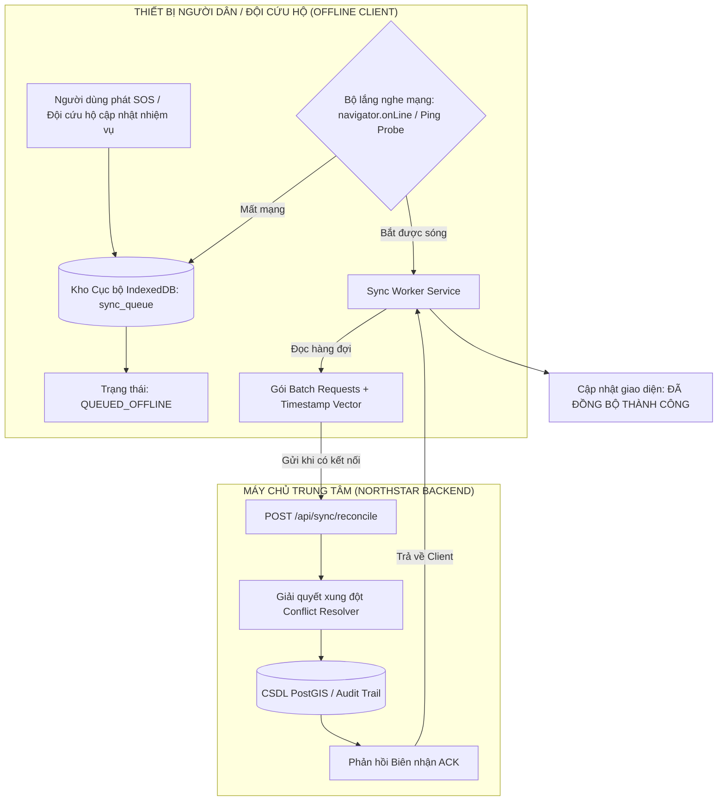
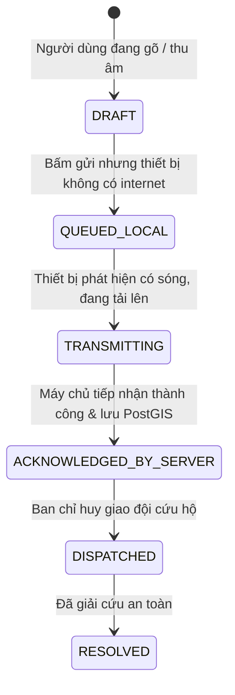

# THIẾT KẾ KIẾN TRÚC NGOẠI TUYẾN & ĐỒNG BỘ DỮ LIỆU
## OFFLINE-FIRST DISTRIBUTED ARCHITECTURE & SYNC PROTOCOL

> **Dự án:** NORTHSTAR – Open-source Emergency Response OS  
> **Tuyên ngôn:** Mất điện, sập trạm phát sóng viễn thông và đứt cáp quang là kịch bản mặc định trong thiên tai. Hệ thống phải được thiết kế để sống sót và vận hành ngoại tuyến có kiểm chứng.  
> **Nguyên tắc kỹ thuật:** Không bao giờ nói dối người dùng rằng SOS đã gửi thành công nếu dữ liệu chỉ mới nằm trên bộ nhớ điện thoại!  

---

## 1. ĐÁNH GIÁ THỰC TẾ CÔNG NGHỆ (REALISTIC TECHNICAL FEASIBILITY)

Nhiều dự án công nghệ thường đưa ra những tuyên bố viển vông về khả năng "kết nối Mesh tự động qua Bluetooth/Wi-Fi Direct trên trình duyệt web". Dưới góc độ của một Principal Systems Architect, chúng ta phải minh bạch ranh giới công nghệ:

| Công nghệ | Khả năng trên Trình duyệt Web (PWA) | Khả năng trên Ứng dụng Native (Android / Embedded) | Đánh giá Thực thi trong NorthStar |
| :--- | :--- | :--- | :--- |
| **Lưu đệm mã nguồn (Service Worker)** | Hoạt động rất tốt (HTML, JS, CSS, Leaflet) | Đã đóng gói sẵn trong tệp nhị phân | **Triển khai ngay** cho cả 3 Portal. |
| **Lưu trữ CSDL cục bộ (IndexedDB)** | Hoạt động rất tốt (Dung lượng 50MB - 1GB) | SQLite cục bộ (Room / CoreData) | **Triển khai ngay** làm kho hàng đợi `SyncQueue`. |
| **Bản đồ ngoại tuyến (Offline Map Tiles)** | Khả thi (Lưu raster tiles vào IndexedDB) | Vector MBTiles lưu vào bộ nhớ trong | **Triển khai lưu đệm bán kính 10km** khu vực thiên tai. |
| **Web Bluetooth / BLE** | Hạn chế nghiêm ngặt (Cần người dùng bấm chọn từng thiết bị, không chạy nền) | Toàn quyền quét và kết nối nền | **Không dùng PWA để tạo mesh**. Đề xuất module Sidecar Native độc lập cho đội cứu hộ. |
| **Wi-Fi Direct / Ad-hoc P2P** | **KHÔNG THỂ (Bị chặn bởi Sandbox trình duyệt)** | Khả thi trên Android (Wi-Fi P2P API) | Đòi hỏi ứng dụng Native riêng biệt trong tương lai. |
| **LoRa Radio (433MHz / 915MHz)** | Không hỗ trợ trực tiếp (Trừ khi qua Web Serial) | Giao tiếp qua cổng USB OTG / Bluetooth Bridge | Dành cho phần cứng chuyên dụng (Disaster Box). |

**Kết luận Kiến trúc:**  
Phân hệ Web PWA của NorthStar tập trung vào **Mô hình Ngoại tuyến Cục bộ Bền bỉ (Local-First Resilient Architecture)**: Lưu trữ hàng đợi trong `IndexedDB`, đệm bản đồ `Leaflet-IndexedDB`, và tự động đồng bộ ngay khi thiết bị tái lập kết nối (dù chỉ là 2G/EDGE chập chờn).

---

## 2. KIẾN TRÚC HÀNG ĐỢI ĐỒNG BỘ NỘI BỘ (CLIENT-SIDE SYNC QUEUE)



### 2.1. Cấu trúc Bản ghi Hàng đợi trong IndexedDB (`sync_queue`)
Mỗi hành động phát sinh trong lúc mất mạng đều được cấp một định danh duy nhất (UUIDv4) do client tự sinh:

```json
{
  "client_record_id": "c7a8b9e0-1234-5678-9abc-def012345678",
  "action_type": "CREATE_SOS | UPDATE_TASK_STATUS | LOG_FIELD_REPORT",
  "payload": {
    "tracking_code": "SOS-2026-7821",
    "lat": 21.5928,
    "lng": 105.8442,
    "people_count": 3,
    "notes": "Đã cắt điện, nước ngập 1.5m"
  },
  "created_at_client_iso": "2026-11-18T00:35:10.123Z",
  "client_logical_clock": 4,
  "sync_status": "PENDING_LOCAL",
  "retry_count": 0,
  "last_error": null
}
```

---

## 3. 4 TRẠNG THÁI MINH BẠCH DỮ LIỆU CỨU NẠN (TRANSPARENT UX STATES)

Hệ thống NorthStar đặt sự an toàn của người dân lên trên sự hào nhoáng. Giao diện phải thể hiện rõ ràng 4 trạng thái để người dân biết chính xác tình hình:



1. **`QUEUED_LOCAL` (Màu vàng cam nhấp nháy):**  
   *"⚠️ Điện thoại hiện đang mất kết nối Internet. Tín hiệu SOS của bạn đã được LƯU AN TOÀN TRÊN MÁY. Hãy giữ máy mở; hệ thống sẽ tự động phát tín hiệu ngay khi bạn di chuyển đến nơi có sóng viễn thông!"*
2. **`TRANSMITTING` (Màu xanh dương xoay):**  
   *"📡 Đang thiết lập kênh truyền tin tới Ban Chỉ huy..."*
3. **`ACKNOWLEDGED_BY_SERVER` (Màu xanh lá):**  
   *"✓ TÍN HIỆU ĐÃ TRUYỀN THÀNH CÔNG TỚI BAN CHỈ HUY! Mã tra cứu: SOS-7821."*
4. **`DISPATCHED` (Màu đỏ cứu nạn):**  
   *"🚨 Đội cứu hộ số 3 (114) đã nhận lệnh và đang di chuyển tới vị trí của bạn!"*

---

## 4. GIAO THỨC GIẢI QUYẾT XUNG ĐỘT (CONFLICT RESOLUTION PROTOCOL)

Khi nhiều đội cứu hộ hoặc thiết bị cùng cập nhật một ca SOS trong tình trạng mạng chập chờn (Offline Split-Brain), máy chủ Backend áp dụng chiến lược giải quyết xung đột như sau:

1. **Quy tắc Trọng tài Trạng thái Tối thượng (Monotonic State Machine):**
   - Trạng thái nhiệm vụ cứu hộ chỉ được tiến lên, không bao giờ được thụt lùi:  
     $$\text{pending} \rightarrow \text{acknowledged} \rightarrow \text{dispatched} \rightarrow \text{in\_progress} \rightarrow \text{resolved}$$
   - Một bản ghi gửi muộn có trạng thái `in_progress` không được ghi đè lên trạng thái `resolved` đã hoàn thành trước đó.
2. **Quy tắc Last-Write-Wins có Gắn Cờ Kiểm toán (LWW with Audit Flag):**
   - Nếu hai cập nhật ghi chú hiện trường gửi lên lệch nhau, hệ thống ghi nhận bản cập nhật có timestamp client mới hơn, đồng thời lưu bản ghi cũ vào bảng `audit_logs` để chỉ huy có thể tra cứu lịch sử tác chiến.
3. **Quy tắc Báo động Trùng lặp (Spatial Deduplication):**
   - Nếu cùng một gia đình có 3 người gửi 3 mã SOS khác nhau ở cùng một tọa độ (bán kính $<30\text{m}$), hệ thống gom thành một **Chùm Cứu Nạn (Rescue Cluster)**, cộng dồn tổng số người cần cứu và gán cho một đội xuồng máy duy nhất tiếp cận.

---

## 5. BẢN ĐỒ NGOẠI TUYẾN TRONG BÁN KÍNH THIÊN TAI (OFFLINE MAP TILES)

Để bản đồ Leaflet không bị trắng xóa khi mất mạng:
- Tích hợp module lưu đệm `Leaflet.TileLayer.IndexedDB`.
- Khi người dùng chọn khu vực quan tâm (Ví dụ: "Khu vực TP. Thái Nguyên" hoặc "Huyện Bảo Yên"):
  - Hệ thống tải trước các mảnh bản đồ OpenStreetMap ở các mức phóng to (Zoom levels 11 đến 16).
  - Dung lượng lưu đệm một huyện trung bình chỉ khoảng **15MB - 35MB**, hoàn toàn phù hợp với bộ nhớ lưu trữ của điện thoại di động và máy tính bảng.
- Trong trường hợp không kịp tải mảnh bản đồ, hệ thống tự động chuyển sang chế độ **Bản đồ Lưới Tọa độ Khẩn cấp (Emergency Tactical Grid)**: hiển thị điểm SOS, khoảng cách theo đường chim bay ($m$), góc phương vị la bàn (Compass Azimuth) và độ sâu ngập nước để xuồng cứu hộ định hướng.
