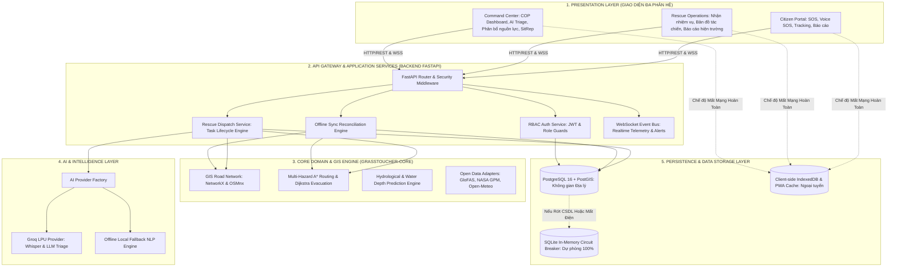
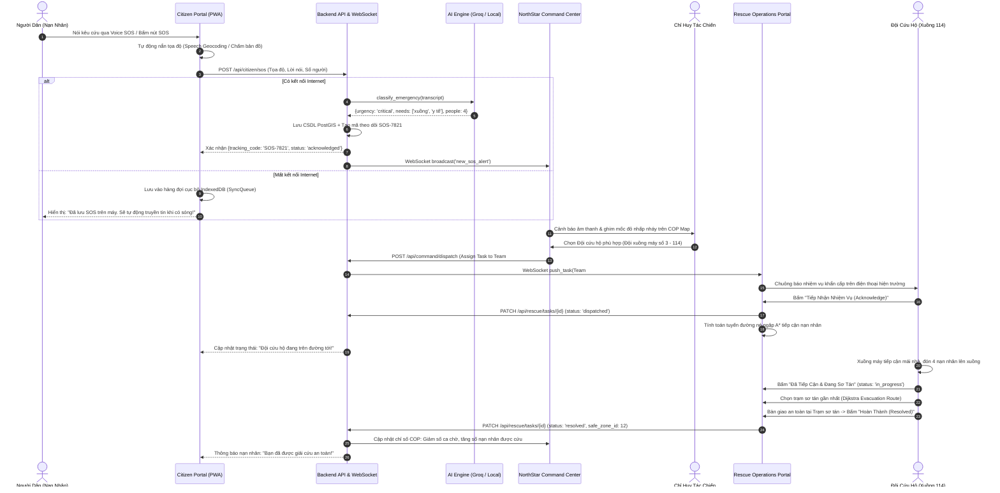

# BẢN VẼ THIẾT KẾ KIẾN TRÚC HỆ THỐNG TỔNG THỂ
## SYSTEM ARCHITECTURE SPECIFICATION – NORTHSTAR RESCUE OS

> **Dự án:** NORTHSTAR – Open-source Emergency Response OS  
> **Mô hình kiến trúc:** Hybrid Centralized & Distributed Architecture (Kiến trúc Lai: Chỉ huy Tập trung & Tác chiến Phân tán)  
> **Nguyên tắc thiết kế:** Offline-First, Resilient by Design, Modular Monolith with Clean Architecture, OSI-Compliant.  

---

## 1. KIẾN TRÚC PHÂN TẦNG TỔNG THỂ (LAYERED ARCHITECTURE)

Hệ thống NORTHSTAR được tổ chức theo kiến trúc phân tầng rõ ràng (Clean / Onion Architecture), loại bỏ hoàn toàn sự phụ thuộc vòng giữa các thành phần:

---

## 2. QUY TRÌNH LUỒNG DỮ LIỆU TÁC CHIẾN CỨU NẠN (END-TO-END DATA FLOW)

Sơ đồ tuần tự thể hiện toàn bộ vòng đời của một yêu cầu cứu hộ từ khi nạn nhân phát tín hiệu cho đến khi được giải cứu an toàn:

---

## 3. KIẾN TRÚC CHI TIẾT CÁC PHÂN HỆ

### 3.1. Phân hệ Citizen Portal (Giao diện Người Dân)
- **Công nghệ:** HTML5, Tailwind CSS, Leaflet GIS, Vanilla JS (Không nặng framework, tải trang dưới 1.2s trên 3G).
- **Trải nghiệm Người Dùng (UX):**
  - **Chế độ Ban Ngày / Ban Đêm Tương phản Cao:** Hỗ trợ nhìn rõ dưới trời mưa gió hoặc khi mất điện ban đêm.
  - **Khả năng tiếp cận (Accessibility):** Phông chữ `Be Vietnam Pro` sắc nét, nút bấm to bản ($>48\text{px}$) dễ thao tác khi ngón tay bị ướt nước.
  - **Phản hồi âm thanh hai chiều:** Web Speech Synthesis tiếng Việt phát thông báo hướng dẫn để nạn nhân đang hoảng loạn có thể nghe thấy ngay cả khi không nhìn vào màn hình.

### 3.2. Phân hệ Rescue Operations (Giao diện Đội Cứu Hộ)
- **Công nghệ:** Mobile-First Web PWA, tối ưu hóa cho màn hình điện thoại và máy tính bảng chuyên dụng trên ca-nô.
- **Năng lực đặc thù:**
  - **Giao diện Tác chiến Hiện trường (Field Tactical View):** Bản đồ chỉ hiển thị các lớp thông tin trọng yếu: Mốc SOS của đội được giao, độ sâu luồng nước, điểm chướng ngại vật (dây điện, ngầm tràn), trạm sơ tán an toàn.
  - **Nút hành động lớn (Large Action Buttons):** "NHẬN LỆNH" $\rightarrow$ "XUẤT PHÁT" $\rightarrow$ "ĐÃ TIẾP CẬN" $\rightarrow$ "HOÀN THÀNH".
  - **Chế độ Tiết kiệm Pin (Extreme Power Saving):** Tùy chọn giao diện tối (True Black OLED) và giảm tần suất GPS khi tàu dừng lại để bảo tồn pin thiết bị cứu hộ.

### 3.3. Phân hệ NorthStar Command (Trung tâm Chỉ huy Điều hành)
- **Công nghệ:** Desktop / Multi-monitor Responsive Web Dashboard.
- **Năng lực đặc thù:**
  - **Bản đồ Tình huống Toàn cảnh (Common Operating Picture - COP):** Cụm điểm (Clustering) các ca SOS, bản đồ nhiệt (Heatmap) nguy cơ sạt lở, biểu đồ xu hướng mực nước sông ngòi thời gian thực.
  - **Bảng Điều phối Lực lượng (Resource Matrix):** Thống kê tức thời: Tổng số đội trực chiến, số xuồng đang cơ động, số ca SOS nguy cấp chưa có đội tiếp cận.
  - **Hệ thống Phát hiện Trùng lặp (Deduplication):** Thuật toán Spatial-Temporal Clustering gom các tin báo cách nhau dưới 100 mét trong vòng 2 giờ thành một sự cố duy nhất, tránh việc phân công trùng lặp.
