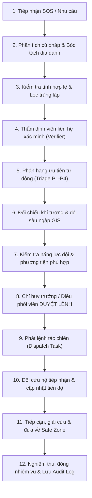

# ĐẶC TẢ YÊU CẦU NGHIỆP VỤ NORTHSTAR COMMAND (COMMAND REQUIREMENTS)
## Chi tiết Yêu cầu Chức năng & Phi chức năng cho Trung tâm Điều phối

---

## 1. YÊU CẦU CHỨC NĂNG THEO 8 PHÂN HỆ CỐT LÕI

### 1.1. INFORMATION HUB (Trung tâm Tiếp nhận & Thẩm định Thông tin)
- **FR-HUB-01 (Đa nguồn tiếp nhận):** Hệ thống phải tiếp nhận đồng thời dữ liệu từ 10 luồng: SOS công dân, Báo cáo sự cố hiện trường, Thời tiết Open-Meteo, Lượng mưa vệ tinh NASA GPM, Mực nước trạm thủy văn GloFAS, Báo cáo vị trí đội cứu hộ, Đăng ký hàng cứu trợ thiện nguyện, Trạng thái điểm sơ tán, Dữ liệu cảnh báo cơ quan phòng chống thiên tai, Dữ liệu không gian viễn thám Sentinel-1 SAR.
- **FR-HUB-02 (Chuẩn hóa cấu trúc bản ghi):** Mọi bản ghi thông tin đầu vào phải được gán siêu dữ liệu chuẩn:
  - `record_id` (UUID v4 duy nhất)
  - `source_type` (`CITIZEN`, `IOT_SENSOR`, `SATELLITE`, `RESCUER`, `VOLUNTEER`, `OFFICIAL_AGENCY`)
  - `hazard_category` (`FLOOD`, `LANDSLIDE`, `STORM`, `MEDICAL_EMERGENCY`, `ISOLATION`)
  - `timestamp_occurred` & `timestamp_ingested`
  - `geom` (Tọa độ WGS84 Point/Polygon) kèm bán kính sai số `accuracy_radius_m`
  - `verification_status` (`RECEIVED`, `VERIFYING`, `VERIFIED`, `REJECTED`, `EXPIRED`)
  - `confidence_score` (Hệ số tin cậy từ 0.0 đến 1.0)
- **FR-HUB-03 (Phát hiện trùng lặp Spatiotemporal Deduplication):**
  - Tự động gom nhóm các báo cáo có khoảng cách địa lý $\le 50\text{ m}$ và thời gian phát sinh cách nhau $\le 30\text{ phút}$.
  - Gắn cờ `DUPLICATE_SUSPECTED` và liên kết bản ghi phụ vào bản ghi gốc (Master Record) để tránh phân công thừa lực lượng.
- **FR-HUB-04 (Kiểm tra bất thường & Cảnh báo dữ liệu cũ):**
  - Đánh dấu cảnh báo khi tọa độ nằm ngoài lãnh thổ Việt Nam hoặc lượng mưa > 300 mm/h (vượt ngưỡng vật lý đo đạc).
  - Tự động đánh dấu `STALE` nếu dữ liệu quan trắc không được cập nhật quá 120 phút.

---

### 1.2. WEATHER MONITORING (Giám sát Thời tiết & Khí tượng)
- **FR-WEA-01 (Thời tiết thực tế & Dự báo):** Tích hợp Open-Meteo API để cập nhật thời gian thực nhiệt độ, lượng mưa tích lũy 1h/24h, hướng gió, tốc độ gió và áp suất khí quyển.
- **FR-WEA-02 (Theo dõi bão & Vệt di chuyển dự báo):** Hiển thị tâm bão, cấp gió bão (thang Beaufort), bán kính gió mạnh và đường đi dự báo 24h - 48h - 72h.
- **FR-WEA-03 (Không làm giả dữ liệu):** Khi API thời tiết gián đoạn, hệ thống phải hiển thị rõ ràng nhãn *"Dữ liệu lưu đệm lúc [HH:mm] - Đang chờ kết nối lại API"* thay vì tự sinh số liệu giả lập.

---

### 1.3. FLOOD INTELLIGENCE (Giám sát Mực nước Sông & Ngập lụt)
- **FR-FLD-01 (Trạm quan trắc thủy văn):** Quản lý mạng lưới trạm đo mực nước trên các lưu vực sông chính (Sông Hồng, Sông Đà, Sông Lô, Sông Cầu, Sông Mã, Sông Thu Bồn, Sông Mê Kông).
- **FR-FLD-02 (Ngưỡng báo động lũ quốc gia):** Đối chiếu mực nước thực đo với 3 cấp báo động chính thức:
  - Báo động 1 (Mực nước bắt đầu tràn bãi thấp)
  - Báo động 2 (Ngập lụt diện rộng vùng ven sông)
  - Báo động 3 (Lũ đặc biệt lớn, đe dọa an toàn đê điều)
- **FR-FLD-03 (Phân loại nguồn ngập trên bản đồ):** Phân biệt tuyệt đối bằng ký hiệu và mã màu độc lập giữa:
  1. Báo cáo bằng mắt thường của người dân (Màu cam chấm gạch).
  2. Số đo cảm biến/trạm thủy văn (Hình khối viền đậm màu xanh/đỏ).
  3. Kết quả phân tích mô hình GIS (Vùng bán trong suốt gradient).
  4. Vùng ngập nước mặt viễn thám Sentinel-1 SAR (Lớp phủ màu lục lam vệ tinh).

---

### 1.4. GIS DISASTER MAP (Bản đồ Tác chiến Thống nhất - COP)
- **FR-GIS-01 (Quản lý đa lớp độc lập):** Cho phép bật/tắt tức thời từng lớp chuyên đề: Lớp SOS, Lớp trạm thủy văn, Lớp sạt lở, Lớp đội cứu hộ, Lớp đội thiện nguyện, Lớp điểm sơ tán, Lớp giao thông chia cắt, Lớp radar mưa.
- **FR-GIS-02 (Bộ lọc tác chiến linh hoạt):** Lọc theo địa giới hành chính (Tỉnh/Thành -> Quận/Huyện -> Phường/Xã), khoảng thời gian (1h qua, 6h qua, 24h qua, toàn bộ đợt thiên tai), và mức độ ưu tiên (P1 Khẩn cấp đến P4 Bình thường).
- **FR-GIS-03 (Bảo vệ PII trên bản đồ):** Không bao giờ hiển thị số điện thoại, số CCCD hoặc địa chỉ cụ thể của nạn nhân trực tiếp lên tooltip bản đồ công khai; chỉ hiển thị mã đơn (`SOS-xxxx`) và số lượng người cần cứu.

---

### 1.5. RESCUE MANAGEMENT (Quản lý Đội Cứu Hộ Chuyên Môn)
- **FR-RES-01 (Hồ sơ năng lực đội):** Quản lý cơ cấu tổ chức đội, danh sách chiến sĩ, đội trưởng, kỹ năng chuyên môn (Lặn cứu nạn, Cứu hộ sạt lở, Sơ cứu y tế chấn thương, Vận hành cano công suất lớn).
- **FR-RES-02 (Quản lý phương tiện & trang bị):** Theo dõi số lượng xuồng cao su, cano máy, xe lội nước, áo phao, thiết bị định vị vệ tinh, tình trạng pin và cơ số xăng dầu dự trữ.
- **FR-RES-03 (Vòng đời trạng thái đội):** Cập nhật trạng thái trực ban theo 5 mức:
  `AVAILABLE` (Sẵn sàng) $\rightarrow$ `ASSIGNED` (Đã nhận lệnh) $\rightarrow$ `ON_MISSION` (Đang tại hiện trường) $\rightarrow$ `RESTING` (Tạm nghỉ phục hồi) $\rightarrow$ `OFFLINE` (Mất tín hiệu).

---

### 1.6. VOLUNTEER MANAGEMENT (Quản lý Lực lượng & Hàng Cứu Trợ Thiện Nguyện)
- **FR-VOL-01 (Xác minh tổ chức thiện nguyện):** Quy trình đăng ký và thẩm định tổ chức thiện nguyện (Tên đoàn, Trưởng đoàn, Số điện thoại xác thực, Giấy giới thiệu/Cam kết cứu trợ).
- **FR-VOL-02 (Quản lý kho hàng cứu trợ - Relief Inventory):** Kiểm kê thời gian thực theo danh mục:
  - Lương thực: Gạo (kg), mì tôm (thùng), đồ hộp (hộp), lương khô (gói).
  - Nước uống: Nước đóng chai (lít), viên lọc nước Aquatabs (viên).
  - Y tế thông thường: Bông băng, cồn khử trùng, thuốc hạ sốt, thuốc tiêu chảy.
  - Đồ dùng dã chiến: Đèn pin, chăn ấm, áo mưa, ủng lội nước.
- **FR-VOL-03 (Phân phối đúng địa chỉ):** Kết nối kho hàng thiện nguyện với danh sách các điểm sơ tán hoặc hộ dân cô lập **đã được điều phối viên COMMAND xác minh**, tránh tình trạng phát thừa ở mặt đường quốc lộ và bỏ sót vùng sâu.

---

### 1.7. SAFE ZONE MANAGEMENT (Quản lý Điểm Sơ Tán An Toàn)
- **FR-SAF-01 (Thuộc tính điểm sơ tán):** Quản lý danh mục trường học kiên cố, nhà văn hóa, trụ sở UBND, trung tâm thể thao với các trường: Sức chứa thiết kế, Số người đang lưu trú thực tế, Nguồn cấp điện dự phòng (Máy phát điện), Nguồn nước sạch dự trữ (ngày), Tình trạng cán bộ y tế túc trực.
- **FR-SAF-02 (Đánh giá khả năng tiếp cận thực tế):** Không đo khoảng cách đường chim bay; phải sử dụng thuật toán Dijkstra trên đồ thị giao thông để xác định xem tuyến đường đi tới điểm sơ tán có bị chia cắt bởi dòng nước lũ hoặc sạt lở hay không.
- **FR-SAF-03 (Cập nhật trạng thái tải):** Tự động chuyển trạng thái `FULL` khi số người đạt $\ge 95\%$ sức chứa để điều hướng đoàn cứu trợ/nạn nhân sang địa điểm thay thế.

---

### 1.8. COMMAND & DISPATCH (Quy trình Điều phối Cứu hộ Cứu trợ 12 Bước)
Mọi ca cứu nạn hoặc nhu cầu cứu trợ tại COMMAND phải tuân thủ nghiêm ngặt quy trình chuẩn sau:

---

## 2. YÊU CẦU PHI CHỨC NĂNG (NON-FUNCTIONAL REQUIREMENTS)

- **NFR-SEC-01 (Bảo mật backend tuyệt đối):** Quyền hạn được kiểm tra ở cấp độ Controller/Router của FastAPI thông qua JWT Claims và cơ chế Role/Scope Guard. Frontend chỉ hiển thị giao diện phù hợp nhưng không quyết định bảo mật.
- **NFR-PERF-01 (Thời gian phản hồi):**
  - Tải bảng điều khiển tổng quan COP: $\le 1.5\text{ giây}$.
  - Tính toán gợi ý phân bổ đội cứu hộ gần nhất: $\le 500\text{ ms}$.
  - Độ trễ phát sóng sự kiện qua WebSocket: $\le 200\text{ ms}$.
- **NFR-RELIABILITY-01 (Tính sẵn sàng cao & Dự phòng):**
  - Hệ thống duy trì hoạt động $99.9\%$ trong các đợt bão lũ.
  - Khi máy chủ cơ sở dữ liệu PostgreSQL gián đoạn kết nối, cơ chế **Circuit Breaker** kích hoạt lưu tạm vào SQLite dã chiến để không làm mất lệnh điều động.
- **NFR-AUDIT-01 (Tính toàn vẹn & Kiểm toán):** Mọi hành động xem dữ liệu cá nhân nạn nhân, thay đổi trạng thái xác minh, duyệt phân công hoặc xuất báo cáo đều phải tự động ghi vào bảng `audit_logs` (lưu IP, User ID, Action, Timestamp, Payload cũ và mới).
