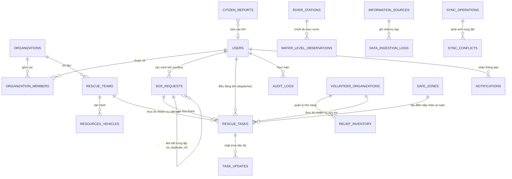

# SƠ ĐỒ THỰC THỂ QUAN HỆ (ENTITY-RELATIONSHIP DIAGRAM - ERD)
## Mô hình Dữ liệu Không gian Quan hệ Đầy đủ cho NORTHSTAR COMMAND

---

## 1. SƠ ĐỒ QUAN HỆ TỔNG THỂ (MERMAID ERD)

---

## 2. GIẢI THÍCH CHI TIẾT CÁC MỐI QUAN HỆ CỐT LÕI

### 2.1. Chuỗi Sự kiện SOS $\rightarrow$ Thẩm định $\rightarrow$ Nhiệm vụ Điều phối (SOS to Task)
- `sos_requests (1) ---- (0..1) rescue_tasks`: Một yêu cầu SOS sau khi được Information Verifier thẩm định là `VERIFIED` sẽ được Dispatcher chuyển đổi thành một ca nhiệm vụ chính thức (`rescue_tasks`).
- `sos_requests (1) ---- (0..n) sos_requests`: Tự liên kết (Self-referencing) phục vụ Spatiotemporal Deduplication. Khi hệ thống phát hiện các báo cáo trùng tọa độ và thời gian, bản ghi phụ sẽ trỏ `is_duplicate_of` về bản ghi gốc.

### 2.2. Lực lượng Cứu hộ Chuyên môn vs Đoàn Thiện nguyện (Separation of Forces)
- `rescue_teams` liên kết với `rescue_tasks` cho các nhiệm vụ nguy cấp (`P1_CRITICAL`, `P2_HIGH`) đòi hỏi cano, xuồng chuyên dụng và kỹ năng lặn cứu nạn.
- `volunteer_organizations` liên kết với `relief_inventory` để quản lý nguồn hàng nhu yếu phẩm và chỉ được phân công thực hiện `task_type = 'RELIEF_DELIVERY'` (phát đồ cứu trợ tại các khu vực an toàn, không có dòng chảy xiết nguy hiểm).

### 2.3. Mạng lưới Điểm Sơ tán (Safe Zones Destination)
- `safe_zones (1) ---- (0..n) rescue_tasks`: Mỗi nhiệm vụ cứu hộ đưa người thoát khỏi vùng ngập đều phải chỉ định một điểm sơ tán đích (`destination_safe_zone_id`) nhằm kiểm soát tự động sức chứa và cung ứng đủ lương thực cho người mới đến.

### 2.4. Tính Bất biến của Nhật ký An ninh (Audit Logs)
- `users (1) ---- (0..n) audit_logs`: Mọi thao tác nhạy cảm (truy xuất số điện thoại nạn nhân, sửa đổi phân loại ưu tiên, duyệt điều động hoặc thay đổi quyền người dùng) đều ghi nhận vào `audit_logs` với bản sao trạng thái trước và sau khi thay đổi (`previous_state`, `new_state` dạng JSONB). Bảng này chỉ cho phép `INSERT` và `SELECT`, nghiêm cấm `UPDATE` và `DELETE`.
