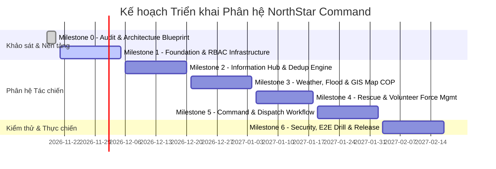

# KẾ HOẠCH TRIỂN KHAI PHÂN HỆ NORTHSTAR COMMAND (IMPLEMENTATION ROADMAP)
## Phân kỳ 7 Milestones, Tiêu chí Hoàn thành & Kế hoạch Phân bổ Nhân sự Tinh gọn

---

## 1. LỘ TRÌNH 7 MILESTONES TRIỂN KHAI

---

## 2. CHI TIẾT CÁC MILESTONES (M0 - M6)

### Milestone 0: Audit & Architecture Blueprint (Hoàn tất)
- **Mục tiêu:** Rà soát hiện trạng 3 repositories (`core`, `backend`, `frontend`), thiết lập bộ 15 tài liệu đặc tả kiến trúc, phân quyền và dữ liệu, xác định rủi ro kỹ thuật.
- **Tiêu chuẩn nghiệm thu:** 15 tài liệu hoàn tất, 28/28 Unit Tests backend vượt qua, người dùng phê duyệt phương án.

### Milestone 1: Foundation & RBAC Infrastructure (Hạ tầng, CSDL & Xác thực)
- **Mục tiêu:** Chạy Alembic migration cho 14 bảng dữ liệu, thiết lập hệ thống JWT Authentication kết hợp Role/Scope Guard (`require_role_and_scope`), xây dựng cấu trúc thư mục frontend `portal-command.html`.
- **Files chính cần tạo / chỉnh sửa:**
  - `GrassToucher-backend/alembic/versions/0003_command_center_schema.py`
  - `GrassToucher-backend/app/core/security.py` & `app/routers/auth.py`
  - `GrassTouchers-Frontend/portal-command.html` (Khung giao diện Dashboard)
- **Tiêu chuẩn nghiệm thu:** Đăng nhập thành công với 7 vai trò, token mang đủ claims quyền hạn; Circuit Breaker SQLite vẫn dự phòng tốt.

### Milestone 2: Information Hub & Deduplication Engine (Tiếp nhận & Thẩm định)
- **Mục tiêu:** Xây dựng module Ingestion tiếp nhận SOS và báo cáo thiên tai, hiện thực thuật toán lọc trùng Spatiotemporal (bán kính 50m / 30 phút), giao diện màn hình xác minh cho Verifier.
- **Files chính cần tạo / chỉnh sửa:**
  - `GrassToucher-backend/app/services/ingestion_service.py`
  - `GrassToucher-backend/app/services/dedup_service.py`
  - `GrassTouchers-Frontend/js/command_verification.js`
- **Tiêu chuẩn nghiệm thu:** Tự động gom nhóm các cuộc gọi trùng lặp; giao diện cho phép thẩm định viên chuyển trạng thái `RECEIVED` $\rightarrow$ `VERIFIED` / `REJECTED`.

### Milestone 3: Monitoring & GIS Disaster Map COP (Giám sát & Bản đồ Toàn cảnh)
- **Mục tiêu:** Tích hợp API Open-Meteo và Copernicus GloFAS, hiển thị trạm thủy văn và mực nước theo 3 cấp báo động lũ, xây dựng bản đồ đa lớp Leaflet với bộ lọc thời gian và địa bàn.
- **Files chính cần tạo / chỉnh sửa:**
  - `GrassToucher-backend/app/routers/weather.py` & `app/routers/readings.py`
  - `GrassToucher-core/grasstoucher_core/graph.py` (Lọc đồ thị theo vùng)
  - `GrassTouchers-Frontend/js/command_map.js` (Multi-layer Leaflet COP)
- **Tiêu chuẩn nghiệm thu:** Bản đồ hiển thị mượt mà > 2.000 điểm ngập và trạm đo; thời tiết cập nhật tự động mỗi giờ.

### Milestone 4: Resource & Logistics Management (Lực lượng & Hậu cần Cứu trợ)
- **Mục tiêu:** Phân hệ quản lý Đội cứu hộ (quân số, cano, trạng thái trực ban) và Đội thiện nguyện (kho hàng cứu trợ gạo, nước, thuốc); quản lý điểm sơ tán an toàn.
- **Files chính cần tạo / chỉnh sửa:**
  - `GrassToucher-backend/app/routers/rescue_teams.py` & `app/routers/volunteers.py`
  - `GrassToucher-backend/app/routers/safe_zones.py`
  - `GrassTouchers-Frontend/js/command_resources.js`
- **Tiêu chuẩn nghiệm thu:** Cập nhật trạng thái đội tức thời qua WebSocket; kiểm soát chính xác tải trọng và chỗ trống của từng điểm sơ tán.

### Milestone 5: Command & Dispatch Workflow (Quy trình Điều phối 12 Bước)
- **Mục tiêu:** Hiện thực hóa quy trình điều động lực lượng tác chiến: Dispatcher duyệt lệnh cứu nạn cho Đội cứu hộ chuyên môn hoặc lệnh cứu trợ cho Đội thiện nguyện; tự động xuất báo cáo SitRep (QĐ 18/2021/QĐ-TTg).
- **Files chính cần tạo / chỉnh sửa:**
  - `GrassToucher-backend/app/services/dispatch_service.py`
  - `GrassToucher-backend/app/routers/sitrep.py`
  - `GrassTouchers-Frontend/js/command_dispatch.js`
- **Tiêu chuẩn nghiệm thu:** Điều phối khép kín một ca cứu nạn từ lúc tiếp nhận đến khi nạn nhân về điểm sơ tán an toàn; sinh báo cáo SitRep định dạng PDF/Markdown chỉ với 1 cú click.

### Milestone 6: Security, Testing & Release (An ninh & Diễn tập Thực chiến)
- **Mục tiêu:** Kiểm toán an ninh toàn diện (OWASP Top 10, PII leakage audit), chạy kịch bản diễn tập giả định bão lũ quy mô lớn (Load testing 1.000 SOS đồng thời), đóng gói Docker Compose 1-lệnh.
- **Files chính cần tạo / chỉnh sửa:**
  - `docker-compose.command.yml`
  - `tests/e2e/test_command_lifecycle.py`
  - `docs/command/OPERATIONAL_MANUAL.md`
- **Tiêu chuẩn nghiệm thu:** Hệ thống vượt qua bài kiểm tra chịu tải; không rò rỉ dữ liệu cá nhân của nạn nhân; khởi chạy hoàn chỉnh với `docker compose up -d`.

---

## 3. PHÂN BỔ NHÂN LỰC TINH GỌN (1 - 3 THÀNH VIÊN)

| Kỹ sư / Thành viên | Trọng tâm Phụ trách | Nhiệm vụ Chi tiết trong 7 Milestones |
| :--- | :--- | :--- |
| **Dev 1: Tech Lead / Fullstack** | Kiến trúc Tổng thể, Security & Realtime | - Thiết kế JWT, RBAC & Geographic Scope Guards - Xây dựng WebSocket Gateway (`/ws/command/live-events`) - Lập trình Dispatch Lifecycle Service & Audit Logging |
| **Dev 2: Backend, GIS & Data** | CSDL PostGIS, Ingestion Pipeline & GIS Core | - DDL Database PostgreSQL & Alembic Migrations - Ingestion Pipeline Open-Meteo, GloFAS & NASA GPM - Thuật toán Spatiotemporal Deduplication & Multi-Hazard Routing |
| **Dev 3: Frontend & UX Specialist** | Giao diện Command Dashboard & Bản đồ Leaflet | - Xây dựng giao diện `portal-command.html` (Tactical Dark Mode) - Bản đồ tác chiến COP đa lớp, MarkerCluster & Timeline - Màn hình thẩm định thông tin cho Verifier & Dispatch board |
