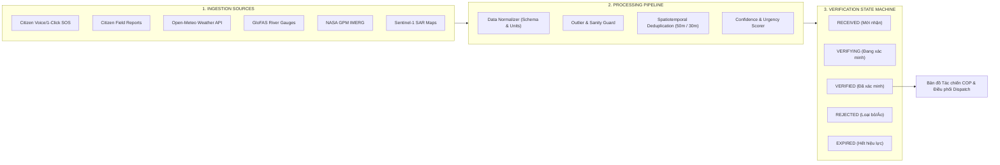

# THIẾT KẾ PHÂN HỆ TIẾP NHẬN & THẨM ĐỊNH THÔNG TIN (INFORMATION HUB DESIGN)
## Kiến trúc Đa nguồn Ingestion, Chuẩn hóa Dữ liệu & Thuật toán Lọc trùng Spatiotemporal

---

## 1. TỔNG QUAN VÀ MỤC TIÊU CỐT LÕI
**Information Hub** là phân hệ ưu tiên số 1 của NORTHSTAR COMMAND, đóng vai trò "cửa ngõ tiếp nhận duy nhất" của toàn hệ sinh thái.

Nguyên tắc cốt lõi: **"Không tự động coi mọi thông tin đầu vào là chính xác"**. Mọi dữ liệu thu nhận được đều phải trải qua pipeline làm sạch, chuẩn hóa, thẩm định độ tin cậy và phân loại vòng đời trước khi xuất hiện trên bản đồ tác chiến của Dispatcher.

---

## 2. QUY TRÌNH TIẾP NHẬN VÀ CHUẨN HÓA DỮ LIỆU (DATA NORMALIZATION)

Mọi gói tin đầu vào (JSON, Webhook, GeoJSON, CSV) đều được chuyển đổi về cấu trúc `StandardInformationRecord`:

| Thuộc tính chuẩn | Kiểu dữ liệu | Ý nghĩa & Quy chuẩn bắt buộc |
| :--- | :--- | :--- |
| `record_id` | `UUID v4` | Định danh duy nhất toàn cầu cho bản ghi. |
| `source_id` | `VARCHAR(50)` | Gắn nhãn nguồn: `CITIZEN_VOICE`, `OPEN_METEO`, `GLOFAS`, `SENTINEL_SAR`. |
| `recorded_at` | `TIMESTAMPTZ` | Thời điểm sự kiện thực tế diễn ra (theo giờ UTC / ISO 8601). |
| `ingested_at` | `TIMESTAMPTZ` | Thời điểm hệ thống Command nhận bản ghi vào hàng đợi. |
| `geom` | `Point / Polygon` | Tọa độ không gian WGS84 (SRID 4326). |
| `accuracy_m` | `FLOAT` | Bán kính sai số định vị (GPS vệ tinh $\approx 5\text{m}$, Cell-tower $\approx 500\text{m}$). |
| `payload` | `JSONB` | Dữ liệu đo lường cụ thể (mực nước cm, lượng mưa mm, số người kẹt). |
| `status` | `ENUM` | `RECEIVED` $\rightarrow$ `VERIFYING` $\rightarrow$ `VERIFIED` $\rightarrow$ `REJECTED` $\rightarrow$ `EXPIRED`. |
| `confidence` | `FLOAT [0.0 - 1.0]`| Điểm số tin cậy tính toán dựa trên mức độ uy tín của nguồn. |

---

## 3. THUẬT TOÁN PHÁT HIỆN TRÙNG LẶP (SPATIOTEMPORAL DEDUPLICATION)

Khi xảy ra sự cố ngập lụt hoặc sạt lở tại một khu dân cư đông đúc, hàng chục người dân có thể cùng gọi SOS hoặc gửi báo cáo cho cùng một sự việc. Thuật toán lọc trùng hoạt động theo cơ chế cửa sổ không-thời gian:

### Quy tắc Gom Cụm (Clustering Rule):
Hai bản ghi $R_A$ và $R_B$ bị coi là trùng lặp nếu thỏa mãn đồng thời 2 điều kiện:
1. **Khoảng cách địa lý Haversine:**
   $$d(geom_A, geom_B) \le 50\text{ mét}$$
2. **Khoảng cách thời gian:**
   $$|recorded\_at_A - recorded\_at_B| \le 30\text{ phút}$$

### Xử lý bản ghi trùng lặp:
- Bản ghi nhận đầu tiên được đánh dấu là **Master Record**.
- Các bản ghi tiếp theo nhận cùng cụm được gán nhãn `DUPLICATE_LINKED` và lưu khóa ngoại `is_duplicate_of = Master_ID`.
- Số lượng người cần cứu và mức độ nước ngập trong Master Record được cập nhật theo giá trị nguy kịch cao nhất để đảm bảo an toàn tối đa cho nạn nhân.

---

## 4. BỘ LỌC BẤT THƯỜNG & DỮ LIỆU LỖI (SANITY & OUTLIER GUARDS)

1. **Rào chắn Ranh giới Địa lý (Boundary Sanity):** Tọa độ phát sinh phải nằm trong lãnh thổ Việt Nam (Vĩ độ $8.0^\circ\text{N} - 24.0^\circ\text{N}$, Kinh độ $102.0^\circ\text{E} - 110.0^\circ\text{E}$). Tọa độ $(0, 0)$ hoặc ngoài vùng biển đặc quyền kinh tế sẽ tự động bị chuyển sang hàng đợi `REJECTED_OUT_OF_BOUNDS`.
2. **Rào chắn Giới hạn Vật lý (Physical Sanity):**
   - Lượng mưa $> 350\text{ mm/h}$ (Vượt kỷ lục khí tượng đo được) $\rightarrow$ Đánh dấu kiểm tra cảm biến.
   - Mực nước sông tăng vọt $> 5\text{ m}$ chỉ trong 10 phút $\rightarrow$ Đánh dấu bất thường thủy văn.
3. **Cơ chế Hết hạn & Dữ liệu Cũ (Stale Data Handler):**
   - Báo cáo ngập nước của người dân tự động chuyển sang `EXPIRED` sau 90 phút nếu không có báo cáo xác nhận mới.
   - Dữ liệu trạm thủy văn tự động hiển thị biểu tượng chấm xám (Mất kết nối) nếu quá 120 phút không nhận được tín hiệu đo mới.
