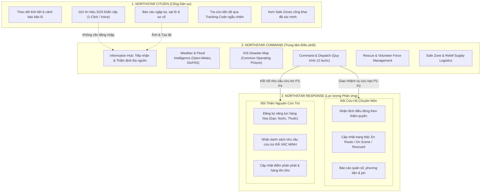

# NORTHSTAR COMMAND – TẦM NHÌN VÀ NGUYÊN TẮC HỆ THỐNG
## Trung tâm Tiếp nhận Thông tin, Giám sát Thiên tai và Phối hợp Cứu trợ Cứu nạn

---

## 1. ĐỊNH VỊ CHIẾN LƯỢC CỦA NORTHSTAR COMMAND
**NORTHSTAR COMMAND** là trung tâm chỉ huy, điều hành thông tin thiên tai và phối hợp liên ngành cứu trợ cứu nạn trực thuộc hệ sinh thái NORTHSTAR (*"One Network. One Mission. Every Life Matters"*).

Hệ thống **KHÔNG PHẢI** là giao diện dành cho người dân và **KHÔNG PHẢI** là ứng dụng tác nghiệp hiện trường của đội cứu hộ.

NORTHSTAR COMMAND được thiết kế chuyên biệt cho:
- **Chỉ huy trưởng / Lãnh đạo Trung tâm (Command Director):** Xem bức tranh tác chiến toàn cảnh (Common Operating Picture - COP), giám sát các cụm sự kiện khẩn cấp, duyệt điều động liên lực lượng.
- **Điều phối viên tác chiến (Dispatcher):** Tiếp nhận, phân loại mức độ khẩn cấp (Triage P1-P4), phân công nhiệm vụ cho đội cứu hộ chuyên môn hoặc kết nối đội thiện nguyện.
- **Nhân viên tiếp nhận & xác minh dữ liệu (Information Verifier):** Đối soát thông tin SOS từ người dân, ảnh hiện trường, lọc báo cáo ảo, phát hiện trùng lặp không gian/thời gian.
- **Chuyên viên phân tích dữ liệu & giám sát thiên tai (Data Analyst):** Theo dõi dữ liệu khí tượng (Open-Meteo, GPM), mực nước sông thực tế (trạm thủy văn), phân tích ngập lụt vệ tinh SAR (Sentinel-1).
- **Điều phối viên lực lượng cứu hộ (Rescue Coordinator):** Quản lý quân số, phương tiện (xuồng, cano, xe lội nước), trang thiết bị chuyên dụng, theo dõi nhật trình đội cứu hộ.
- **Điều phối viên cứu trợ thiện nguyện (Relief Coordinator):** Quản lý các tổ chức thiện nguyện, kết nối kho hàng cứu trợ (lương thực, nước uống, thuốc men) với nhu cầu dân sinh đã xác minh.
- **Quản trị viên kỹ thuật (Super Admin):** Cấu hình hạ tầng, tích hợp nguồn dữ liệu, giám sát kết nối API, quản trị tài khoản và phân quyền theo phạm vi.

---

## 2. NGUYÊN TẮC PHÂN TÁCH BA NHÓM PHÂN HỆ NGHIỆP VỤ

Hệ sinh thái NORTHSTAR phân lập triệt để 3 nhóm người dùng và 3 phân hệ nghiệp vụ độc lập:

### Ranh giới an toàn thông tin bắt buộc:
1. **Người dân:** Không được xem dashboard COMMAND, không xem danh sách nạn nhân khác, không xem tọa độ nhạy cảm của các đội cứu hộ.
2. **Đội thiện nguyện:** Không tự ý tiếp nhận nhiệm vụ nguy hiểm (sạt lở, nước lũ xiết); không được xem toàn bộ dữ liệu cá nhân (PII) của nạn nhân ngoài những thông tin tối thiểu cần thiết để giao hàng (địa chỉ điểm tiếp nhận an toàn).
3. **Đội cứu hộ:** Chỉ xem các ca cứu hộ được phân công trực tiếp trên địa bàn phụ trách; không xem dữ liệu của đơn vị khác nếu chưa được cấp quyền liên vùng.
4. **Nhân sự COMMAND:** Phân quyền theo vai trò (Role-Based Access Control) kết hợp phạm vi địa lý (Geographic Scope) và phạm vi tổ chức (Organization Scope).

---

## 3. NGUYÊN TẮC VẬN HÀNH BẤT DI BẤT DỊCH (NON-NEGOTIABLES)

1. **Con người là người quyết định cuối cùng (Human-in-the-Loop):** Hệ thống và thuật toán AI chỉ đóng vai trò phân loại, gợi ý và phát hiện bất thường. Mọi quyết định điều động xuồng, cano hoặc lực lượng vào vùng nguy hiểm đều phải do Chỉ huy trưởng hoặc Điều phối viên xác nhận.
2. **Không tự suy diễn dữ liệu:** Dữ liệu đo từ trạm thủy văn, báo cáo từ người dân, kết quả mô phỏng thủy lực và dự báo khí tượng phải được phân định bằng nhãn, màu sắc và độ tin cậy riêng biệt trên bản đồ. Không bao giờ gộp chung hoặc làm giả độ sâu ngập khi chưa có cơ sở đo lường.
3. **Bảo mật PII & Quyền riêng tư nạn nhân:** Số điện thoại, danh tính và tình trạng sức khỏe của nạn nhân được mã hóa ở mức lưu trữ và giới hạn hiển thị theo phân quyền nghiêm ngặt.
4. **Minh bạch trạng thái dữ liệu:** Mọi thông tin tiếp nhận vào hệ thống đều phải đi qua 5 trạng thái vòng đời:
   - `RECEIVED`: Mới tiếp nhận từ nguồn.
   - `VERIFYING`: Đang trong tiến trình kiểm tra thực địa / liên lạc.
   - `VERIFIED`: Đã xác minh tính chính xác và sẵn sàng điều phối.
   - `REJECTED`: Thông tin ảo, trùng lặp hoặc không chính xác.
   - `EXPIRED`: Dữ liệu đã quá thời hạn hiệu lực.
