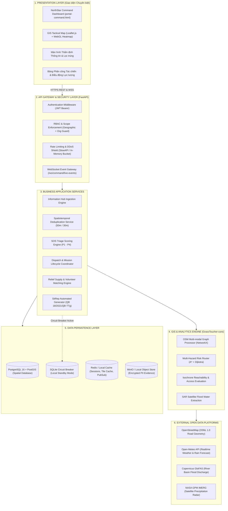

# THIẾT KẾ KIẾN TRÚC HỆ THỐNG NORTHSTAR COMMAND (SYSTEM ARCHITECTURE)
## Kiến trúc Đa tầng, Mô hình Tương tác 3 Repositories & Cơ chế Điều hành Thời gian thực

---

## 1. MÔ HÌNH KIẾN TRÚC TỔNG THỂ ĐA TẦNG (LAYERED ARCHITECTURE)



---

## 2. MÔ HÌNH HỢP TÁC VÀ GIAO TIẾP 3 REPOSITORIES

Dự án duy trì sự phân tách trách nhiệm (Separation of Concerns) tuyệt đối giữa 3 kho mã nguồn:

### 1. `GrassTouchers-Frontend` (Phân hệ Giao diện Người dùng)
- **Công nghệ:** HTML5, Tailwind CSS, Vanilla JS module, Leaflet.js, Lucide Icons.
- **Trách nhiệm trong COMMAND:**
  - Cung cấp giao diện bảng điều khiển tác chiến `portal-command.html`.
  - Quản lý các view trực quan: Bức tranh toàn cảnh (COP), Trung tâm thẩm định thông tin, Bản đồ độ sâu ngập, Quản lý đội cứu hộ/thiện nguyện và Quản lý kho hàng.
  - Kết nối WebSocket tới máy chủ Backend để cập nhật tức thời khi có bản ghi SOS hoặc cảnh báo thiên tai mới.
  - Thực thi cơ chế che mờ dữ liệu cá nhân (PII Masking) đối với các tài khoản không có quyền xem thông tin chi tiết.

### 2. `GrassToucher-backend` (Phân hệ Xử lý Nghiệp vụ & Dữ liệu)
- **Công nghệ:** Python 3.12, FastAPI, SQLAlchemy 2.0 / Psycopg3, Alembic, Pydantic v2.
- **Trách nhiệm trong COMMAND:**
  - Tiếp nhận toàn bộ luồng dữ liệu từ các cổng (Citizen, Cứu hộ, Open Data APIs).
  - Đảm nhận toàn bộ logic xác thực JWT, phân quyền đa tầng RBAC kết hợp Scope địa lý.
  - Điều phối quy trình tác chiến 12 bước (Command & Dispatch Lifecycle).
  - Tự động ghi chép Audit Log bất biến cho mọi thao tác can thiệp hệ thống.
  - Quản lý cơ sở dữ liệu không gian PostgreSQL/PostGIS và cơ chế dự phòng Circuit Breaker SQLite.

### 3. `GrassToucher-core` (Lõi Tính toán Không gian & Trí tuệ Nhân tạo)
- **Công nghệ:** Python 3.12, NetworkX, OSMnx, Shapely, GeoPandas, Scikit-learn.
- **Trách nhiệm trong COMMAND:**
  - Độc lập hoàn toàn với web framework, chỉ giao tiếp thông qua Python API / Service Interfaces.
  - Trích xuất đồ thị hình học giao thông từ OpenStreetMap.
  - Tính toán tuyến đường cứu hộ an toàn cho từng loại phương tiện (xe tải gầm cao, xuồng, cano).
  - Đánh giá khả năng tiếp cận thực tế tới các điểm sơ tán (Safe Zone Reachability).
  - Phân tích ranh giới ngập nước từ ảnh vệ tinh Sentinel-1 SAR.
  - **Quy tắc bất biến:** `core` chỉ trả về kết quả tính toán và gợi ý phương án tối ưu, tuyệt đối không tự ý ra lệnh điều động lực lượng trên hệ thống.

---

## 3. CƠ CHẾ ĐIỀU HÀNH THỜI GIAN THỰC (REALTIME WEBSOCKET PROTOCOL)

Để bảo đảm thời gian cập nhật thông tin trong tâm bão lũ dưới 1 giây, hệ thống thiết lập kênh WebSocket chuyên dụng tại `/ws/command/live-events`:

```json
{
  "event_type": "NEW_SOS_TRIGGERED",
  "timestamp": "2026-11-18T05:30:15Z",
  "payload": {
    "sos_id": "8f9a2b1c-7d3e-4f5a-9b1c-2d3e4f5a6b7c",
    "tracking_code": "SOS-2026-9182",
    "location": { "lat": 21.0285, "lng": 105.8542 },
    "urgency_level": "P1_CRITICAL",
    "hazard_type": "flash_flood",
    "people_count": 4,
    "has_children_or_elderly": true,
    "source": "citizen_voice_sos",
    "verification_status": "RECEIVED"
  }
}
```

- **Broadcasting Filter:** Sự kiện chỉ được đẩy tới các Dispatcher và Verifier đang trực ban tại phạm vi địa lý quản lý (ví dụ: Dispatcher Hà Nội chỉ nhận các sự kiện thuộc Hà Nội và vùng lân cận).
- **Heartbeat & Reconnection:** Client tự động gửi ping mỗi 15 giây; khi mất kết nối mạng 4G/Wifi, client tự động retry theo cơ chế Exponential Backoff và chuyển sang polling REST API dự phòng.

---

## 4. BẢO VỆ CHỐNG SẬP VỚI MÔ HÌNH DỰ PHÒNG CIRCUIT BREAKER

Trong điều kiện bão lớn gây mất điện diện rộng làm ngắt kết nối máy chủ cơ sở dữ liệu PostgreSQL:
1. `app/db.py` liên tục giám sát sức khỏe kết nối DB. Nếu có 3 yêu cầu liên tiếp bị timeout hoặc lỗi kết nối, trạng thái chuyển sang `OPEN` (Circuit Breaker kích hoạt).
2. Toàn bộ các router chuyển tiếp tác vụ ghi sang `fallback_storage.py` (sử dụng SQLite in-memory / SQLite file cục bộ có mã hóa).
3. Giao diện COMMAND hiển thị huy hiệu vàng: *"Đang vận hành trên CSDL dã chiến dự phòng"*. Mọi ca cứu hộ và lệnh điều phối vẫn được lưu trữ nguyên vẹn và tự động đồng bộ ngược lại PostgreSQL ngay khi kết nối được khôi phục.
