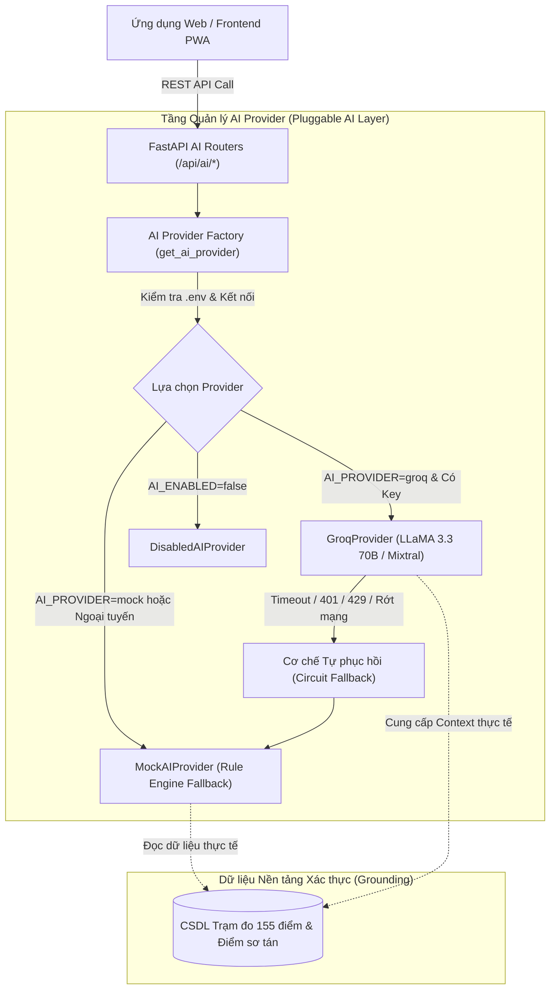

# TÀI LIỆU KỸ THUẬT: TÍCH HỢP GROQ API VÀO HỆ SINH THÁI AI NORTHSTAR / FLOODNAV

> **Dự án:** NorthStar / FloodNav — Hệ thống Trí tuệ Thiên tai & Điều phối Cứu nạn Khẩn cấp Việt Nam  
> **Giấy phép:** Apache-2.0 License (100% Mã nguồn mở, Tuân thủ tuyệt đối Không Vendor Lock-in)  
> **Kiến trúc:** Pluggable AI Provider Layer với cơ chế Dự phòng Ngoại tuyến 100% (Offline Fallback Engine)

---

## 1. Tổng quan Kiến trúc Tầng AI (Architecture Overview)

Hệ thống được thiết kế theo nguyên lý **Pluggable & Decoupled Architecture**. Groq Cloud API đóng vai trò là một **AI Provider tùy chọn (Optional)** tăng tốc suy luận ngữ nghĩa (LPU Inference Acceleration), không phải là thành phần phụ thuộc sống còn. Khi mất kết nối Internet, hết quota, hoặc API Key bị thiếu, hệ thống tự động kích hoạt **Rule-based Offline Provider** mà không làm gián đoạn hay treo máy chủ backend.



---

## 2. Bốn Năng lực AI Cốt lõi (Core AI Capabilities)

### 2.1. Phân tích Báo cáo Thiên tai (Disaster Report Analysis)
- **Endpoint:** `POST /api/ai/analyze-report`
- **Nghiệp vụ:** Tiếp nhận báo cáo ngôn ngữ tự nhiên từ cộng đồng hoặc tin tức; bóc tách tự động:
  - Loại thiên tai (`ngập lụt`, `lũ quét`, `sạt lở đất`, `bão & giông lốc`, `triều cường`).
  - Địa bàn xảy ra (Tỉnh/thành phố, Quận/huyện, Tuyến đường).
  - Thời gian ghi nhận.
  - Nhận diện các thông tin quan trọng còn thiếu (độ sâu, số người, tọa độ GPS).
  - Phân loại mức độ khẩn cấp sơ bộ (`low`, `medium`, `high`, `critical`).

### 2.2. Tổng hợp Thông tin Thiên tai (Disaster Information Summarization)
- **Endpoint:** `POST /api/ai/summarize-disaster`
- **Nghiệp vụ:** Tổng hợp đa nguồn báo cáo theo khu vực và cửa sổ thời gian (12h, 24h, 48h):
  - Tóm tắt diễn biến tổng thể và xu thế đỉnh lũ.
  - Phân nhóm báo cáo tương đồng (`Lũ sông & Ngập úng`, `Lũ bùn quét & Sạt lở đồi núi`, `Sự cố cầu đường`).
  - Đánh dấu và lọc bỏ các tin đồn sai sự thật trên mạng xã hội (ví dụ: tin đồn vỡ đập).

### 2.3. Trợ lý Trực ban Cứu hộ 24/7 (Emergency Assistant Chat)
- **Endpoint:** `POST /api/ai/chat` (và tương thích ngược `POST /api/ai/assistant`)
- **Nghiệp vụ:** Tư vấn trực tiếp người dân dựa trên **Dữ liệu thật của Backend**:
  - Không tự bịa đặt số liệu trạm quan trắc hoặc lượng mưa.
  - Hướng dẫn lộ trình né ngập cho phương tiện (xe máy cấm ngập ≥20cm, ô tô ≥30cm).
  - Kỹ năng sinh tồn khẩn cấp: an toàn điện, đối phó lũ quét, lọc nước mưa sạch.
  - Tích hợp nút hành động 1-chạm: mở modal SOS, điều hướng tới trạm sơ tán gần nhất.

### 2.4. Phân loại Yêu cầu Cứu trợ SOS (Rescue Information Classification)
- **Endpoint:** `POST /api/ai/classify-emergency`
- **Nghiệp vụ:** Phân loại yêu cầu cứu hộ từ hiện trường:
  - Nhận diện nhu cầu: Sơ tán, lương thực, nước sạch, y tế cấp cứu, xuồng máy, an toàn điện.
  - Trích xuất số lượng nhân khẩu mắc kẹt.
  - Định dạng nhóm đối tượng đặc biệt dễ tổn thương (trẻ nhỏ, người già liệt giường, phụ nữ mang thai).
  - Tạo chỉ thị tác chiến ngắn gọn cho đội phản ứng nhanh.

---

## 3. Hướng dẫn Thiết lập & Biến môi trường

1. Tạo file `.env` từ `.env.example`:
   ```bash
   cp .env.example .env
   ```

2. Cấu hình các biến môi trường:
   ```env
   # Bật/tắt AI Provider
   AI_ENABLED=true
   AI_PROVIDER=groq

   # Groq Cloud API Key (Đăng ký miễn phí tại https://console.groq.com)
   # Để trống nếu muốn chạy ở chế độ 100% Ngoại tuyến / Rule Engine
   GROQ_API_KEY=gsk_your_groq_api_key_here

   # Mô hình khuyên dùng: LLaMA 3.3 70B Versatile
   GROQ_MODEL=llama-3.3-70b-versatile

   # Thời gian chờ tối đa (giây) trước khi tự động fallback sang ngoại tuyến
   AI_TIMEOUT_SEC=12.0
   ```

3. Chạy kiểm thử tự động (Unit Test Suite):
   ```bash
   python -m unittest tests/test_ai_provider.py -v
   ```
   *Kết quả: 13/13 test cases PASSED (100% Mocked, không tiêu tốn token/quota ngoài).*

---

## 4. Cơ chế Hoạt động khi Mất Internet (Offline Resilience)

- **Không gửi request vô tận:** Khi mất mạng hoặc DNS không phân giải được Groq API, kết nối sẽ bị ngắt tức thì bởi timeout ngắn (12s).
- **Không gây nghẽn Thread:** Toàn bộ cuộc gọi Groq sử dụng `httpx.AsyncClient` bất đồng bộ trên luồng sự kiện I/O của FastAPI.
- **Dự phòng dữ liệu nội bộ:** `MockAIProvider` phân tích văn bản tiếng Việt dựa trên từ điển thực thể thiên tai và luật chuyên gia chuẩn của Ban Chỉ huy PCTT & TKCN.
- **Cờ trạng thái minh bạch:** Mọi phản hồi API đều mang cờ `is_fallback: true/false` và `provider_used` để Frontend và người giám sát nắm rõ nguồn gốc xử lý.

---

## 5. Giới hạn & Cảnh báo Trách nhiệm (System Limitations)

1. **Không thay thế quyền ra quyết định của con người:** AI chỉ đóng vai trò phân tích sơ bộ và gợi ý tác chiến. Mọi quyết định phát lệnh cảnh báo thiên tai chính thức, lệnh cấm đê điều hoặc di tản cưỡng chế thuộc thẩm quyền của Ban Chỉ huy PCTT & TKCN theo luật định.
2. **Nguyên tắc Chống Bịa đặt (Zero Hallucination Grounding):** Trợ lý AI được prompt nghiêm ngặt không tự sáng tác ra tọa độ hoặc mực nước lũ giả định. Nếu một vị trí chưa có cảm biến IoT hoặc báo cáo thực tế, AI phải thông báo rõ tình trạng thiếu dữ liệu.
